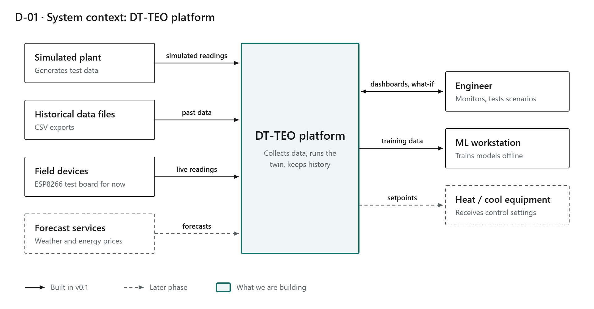
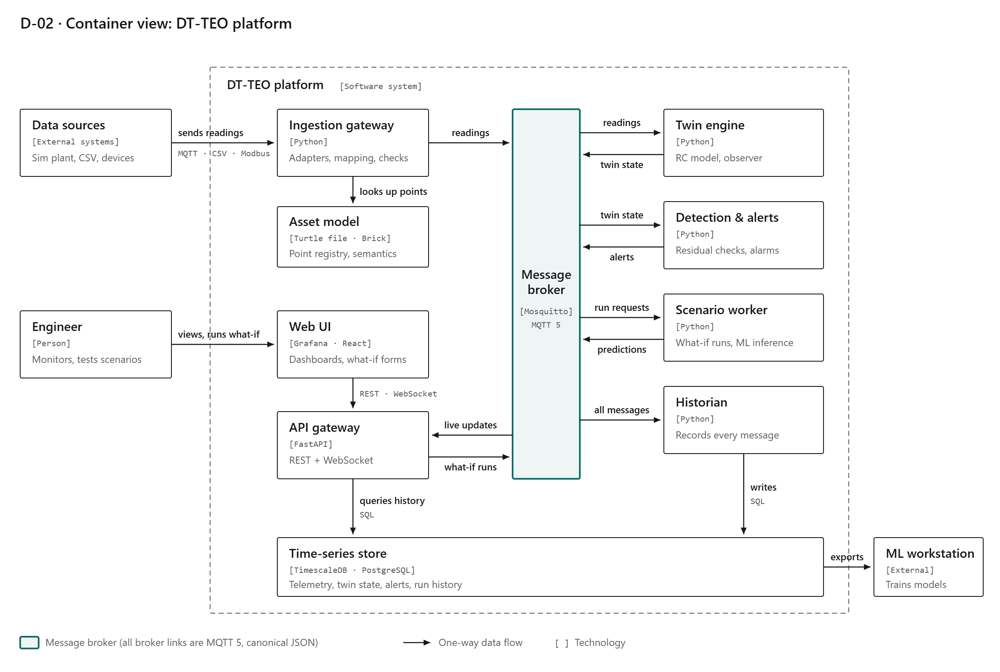
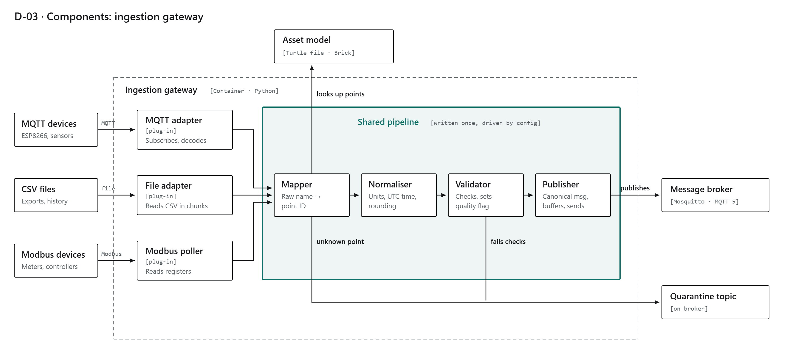
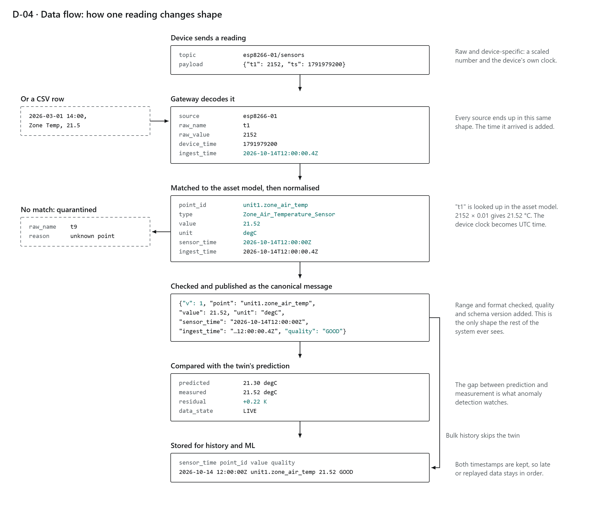
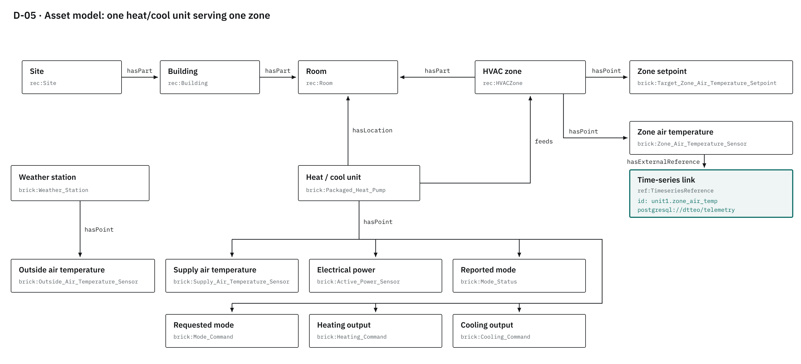
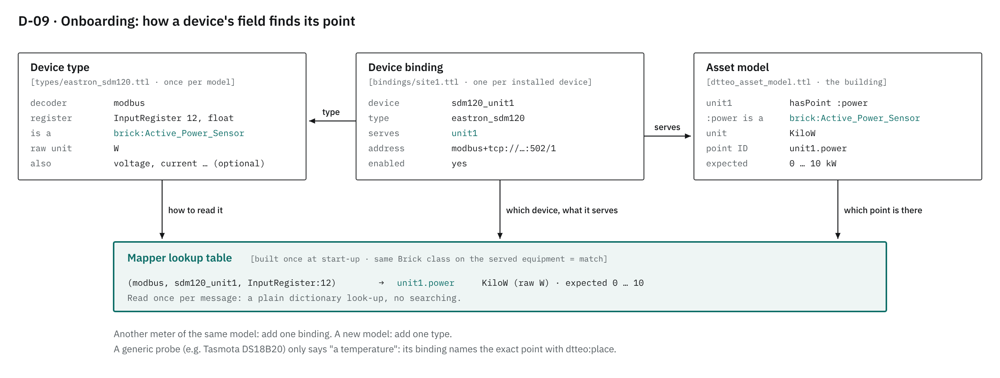

# DT-TEO v0.1: how it works (short guide)

**What this is:** a quick, practical guide to what has been built so far, how the pieces fit, and how to use them. It stays short on purpose. Each section points to the file or source with the full detail.

- Full design and reasoning: [`README.md`](README.md)
- Step-by-step build notes: [`services/ingestion-gateway/NOTES.md`](services/ingestion-gateway/NOTES.md)
- Every source used, and which file uses it: [`SOURCES.md`](SOURCES.md)

*Last updated 29 October 2026 (after stage 3c).*

---

## 1. The idea in one picture



Data from devices and files comes **in**. The platform turns it into **one standard format**, keeps it, compares it with a model (the "twin"), and lets an engineer **test what-if scenarios**. There's no real building yet: data comes from test devices and simulations, so everything runs on one PC.

**The main rule:** anything that touches a specific device or vendor lives at the edge, in the ingestion gateway. Everything after it only ever sees one clean format, so devices, models and storage can be swapped without rewriting the rest.

---

## 2. What runs, and what's built so far



| Part | What it does | Status |
|---|---|---|
| Message broker (Mosquitto) | The "post office" every service talks through (MQTT); saves queued messages to disk | Built (`docker-compose.yml`, `broker/mosquitto.conf`) |
| **Ingestion gateway** | Turns any device's data into standard messages | **Built** (`services/ingestion-gateway/`) |
| Asset model | Describes the building, equipment and sensors | Built, placeholder unit (`dtteo_asset_model.ttl`) |
| Time-series store (PostgreSQL 18 + TimescaleDB) | Keeps every reading | **Built** (`storage/`, [ADR-002](decisions/ADR-002-database-layout.md)) |
| Historian | Writes messages into the store | **Built** (`services/historian/`) |
| Simulated plant, twin engine, scenario worker | Physics model, live twin, what-if runs | Later stages |
| Grafana dashboard | Readings, hourly means, energy per hour, mode, quality, quarantine | **Built** (`grafana/`, http://localhost:3000) |
| API | For the UI and ML work | Later stages |

---

## 3. Inside the ingestion gateway



Every raw message goes through five steps, in this order:

| Step | What it does | File |
|---|---|---|
| Decoder | Reads the device's own format into plain *field, value, time* records. One per format. | `gateway/decoders/` |
| Mapper | Finds which point each field is, using the model files (section 6) | `gateway/mapper.py` |
| Normaliser | Translates codes ("2" → "cool"), converts units (°F → °C, W → kW), makes times UTC | `gateway/normaliser.py`, `units.py` |
| Validator | Sets a quality flag: GOOD, SUSPECT or BAD (section 7) | `gateway/validator.py` |
| Publisher | Sends the standard message to the broker (MQTT 5); holds messages if the broker is briefly down, and logs if any are dropped | `gateway/pipeline.py`, `service.py` |

Anything that can't be read, mapped or converted goes to **quarantine**, with the original message and the reason. So does a message that hits a bug in the gateway. Nothing is silently dropped.

---

## 4. One reading, end to end



The example is a real format: an ESP8266 running Tasmota with a temperature probe. Steps 1 to 4 are built; storing and the twin come in later stages.

---

## 5. Key ideas, briefly

### MQTT: how services talk

- Messages are published to **topics**, text addresses like `dt/v1/telemetry/site1/unit1/zone_air_temp`. Subscribers can use wildcards: `+` = one level, `#` = everything below.
- **QoS 1** = "at least once": resent until the receiver confirms. **Retained** = the broker keeps the last message for late subscribers (used for online/offline status). **Last Will** = a message the broker sends for you if you drop off.
- Devices publish on `raw/...`; only the gateway reads `raw/` and only the gateway writes `dt/v1/telemetry/...`.

More: [`contracts/topics.md`](contracts/topics.md) · [MQTT 5.0 spec](https://docs.oasis-open.org/mqtt/mqtt/v5.0/os/mqtt-v5.0-os.html) · [HiveMQ topic best practices](https://www.hivemq.com/blog/mqtt-essentials-part-5-mqtt-topics-best-practices/)

### The canonical message: the one standard format

```json
{"v": 2, "site": "site1", "point": "unit1.zone_air_temp", "value": 21.4, "unit": "DEG_C",
 "sensor_time": "2026-10-18T10:22:00.000Z", "ingest_time": "2026-10-18T10:22:01.000Z",
 "time_source": "device", "source": "tasmota:tasmota_zone1", "quality": "GOOD"}
```

Two times: when it was **measured** and when it **arrived**, so late or replayed data stays in order. `time_source` says whether the measured time came from the device or, if it sent none, from us. `site` + `point` identifies the reading even when there are several sites. A reading that isn't GOOD also carries `qc`: which checks flagged it, and why. The shape is close to the IETF sensor standard [SenML (RFC 8428)](https://datatracker.ietf.org/doc/rfc8428/).

More: [`contracts/canonical_message.schema.json`](contracts/canonical_message.schema.json) (machine-checkable rules) · quarantine format: [`contracts/quarantine_message.schema.json`](contracts/quarantine_message.schema.json)

### The semantic model: what each point *means*

The message carries a point ID, not its meaning. Meaning lives in the **asset model**, written in **Turtle**, a text format for RDF. RDF stores facts as simple three-part sentences ("triples"): *subject, relationship, object*.

```turtle
:unit1 a brick:Packaged_Heat_Pump ;      # unit1 IS A packaged heat pump
    brick:feeds :zone1 ;                 # it feeds (serves) zone 1
    brick:hasPoint :power .              # it has a point called "power"

:power a brick:Active_Power_Sensor ;     # power IS AN active power sensor
    brick:hasUnit unit:KiloW .           # measured in kilowatts
```

Four standard vocabularies are used, each for one job:

| Vocabulary | Used for | Prefix |
|---|---|---|
| [Brick](https://docs.brickschema.org/brick/relationships.html) | Equipment, sensors and how they connect (`feeds`, `hasPoint`) | `brick:` |
| RealEstateCore | Spaces: site, building, room, HVAC zone | `rec:` |
| [QUDT](https://qudt.org/vocab/unit/DEG_C) | Units, with their conversion factors (used by `units.py`) | `unit:` |
| [Brick ref schema](https://docs.brickschema.org/metadata/timeseries-storage.html) | Links a point to its stored data (`unit1.power`) | `ref:` |

Why bother: software can ask "give me every zone temperature sensor fed by a heat pump" without knowing anyone's naming habits. That's how the gateway finds points (section 6), and later how the twin and dashboards will.



More: [`dtteo_asset_model.ttl`](dtteo_asset_model.ttl) (commented) · README section 5 · [brickschema tool](https://brickschema.readthedocs.io/en/stable/)

---

## 6. Adding devices: types and bindings



| File | Written | Says |
|---|---|---|
| **Device type** (`mappings/types/*.ttl`) | Once per **model** of device | What it sends, where each value sits, what kind of point it feeds, its raw unit and sensor range |
| **Device binding** (`mappings/bindings/site1.ttl`) | Once per **installed** device | Which type it is, which equipment it serves, how to reach it, on/off |
| **Asset model** (`dtteo_asset_model.ttl`) | Once per building | Which points exist, their units and expected ranges |

At start-up the mapper combines them into one lookup table. If anything doesn't fit (a typo, a missing point, two devices feeding one point) it **refuses to start** and says what to fix.

This split follows the W3C Web of Things idea of a [Thing Model](https://www.w3.org/TR/wot-thing-description11/#thing-model) (a model of device) vs a Thing Description (one real device). Modbus registers use the [W3C WoT Modbus terms](https://w3c.github.io/wot-binding-templates/bindings/protocols/modbus/index.html).

More: [`mappings/DESIGN.md`](mappings/DESIGN.md) (design and sources) · [`mappings/dtteo_onboarding.ttl`](mappings/dtteo_onboarding.ttl) (every term, commented)

---

## 7. Quality flags and quarantine

| Outcome | When | Where it goes |
|---|---|---|
| GOOD | Passed every check | Telemetry topic |
| SUSPECT | Outside the **expected** range for that point (e.g. 2 °C in an occupied room) | Telemetry topic, flagged |
| SUSPECT (late) | Arrived more than 6 h after it was measured (e.g. replayed after an outage): still a real reading | Telemetry topic, flagged |
| BAD | Outside what the **sensor can measure**, or a time in the future | Telemetry topic, flagged |
| Quarantine | Couldn't be read, mapped or converted, or hit a gateway bug | `dt/v1/quarantine/{source}` |
| Skipped (counted) | A field its device type marks optional, with no point in the asset model (e.g. Acme's humidity) | Not published; counted in the gateway log once a minute |

The checks follow QARTOD, the US IOOS standard for real-time sensor data quality, as implemented in [ioos_qc](https://github.com/ioos/ioos_qc) (one deliberate difference: late readings are SUSPECT, not BAD; see the validator header). The reasons travel in the message's `qc` list and appear in the gateway log.

More: [`gateway/validator.py`](services/ingestion-gateway/gateway/validator.py) (header explains each check)

---

## 8. Real, made-up, or placeholder?

Worth knowing before trusting anything:

| Thing | What it is |
|---|---|
| Acme, Borealis | **Made-up** test vendors (`testing/vendors/`), kept to prove two formats become one |
| Tasmota (ESP8266), Eastron SDM120 | **Real** published formats; tested with sample messages, no hardware connected yet |
| The heat/cool unit, zone, room | **Placeholder** until Botanic's unit is specified |
| Expected ranges on points | **Placeholders** chosen by us, marked in `dtteo_asset_model.ttl` |
| Mosquitto queue size, session expiry (1 week) | **Our choice** for feasibility volumes, explained in `broker/mosquitto.conf` and `gateway/service.py` |
| DS18B20 sensor range (-55 to 125 °C) | **Real**, from the datasheet |

---

## 9. How to…

All commands are run in Windows `cmd`, from `v0.1\services\ingestion-gateway` with the venv active (`venv\Scripts\activate`), unless stated. First time (or after step 2k): `pip install -r requirements-dev.txt` (the Docker image only installs `requirements.txt`).

| I want to… | Do this |
|---|---|
| Check everything still works | `python -m pytest` |
| See every field → point mapping, and warnings | `python -m gateway.mapper` |
| See sample messages go through the pipeline | `python -m gateway.demo` |
| Run the live stack (broker + gateway + Acme) | from `v0.1`: `docker compose --profile acme up --build` |
| First time with the database | from `v0.1`: `copy .env.example .env`, set the passwords, then `docker compose up -d` (details: `storage/NOTES.md`) |
| See what's being stored | `docker compose logs -f historian`, or Grafana at http://localhost:3000 |
| Back up the database | from `v0.1`: `docker compose run --rm backup` |
| Wipe the broker queue and the database (clean start) | from `v0.1`: `docker compose down -v` |
| Watch messages / gateway log | `docker compose exec mosquitto mosquitto_sub -v -t "dt/v1/#"` · `docker compose logs -f gateway` |
| Add another device of a known model | Add one block to `mappings/bindings/site1.ttl`, then run the mapper check |
| Add a new model of device | Add a file in `mappings/types/` (copy the closest one); a new decoder only if it's a new *format* |
| Add a new point (e.g. humidity) | Add it to `dtteo_asset_model.ttl` with its Brick class, unit, time-series ID and value kind (`measurement` / `total` / `state`) |
| Change an expected range | Edit `dtteo:expectedRange` on the point in `dtteo_asset_model.ttl` |
| Update the source index | from `v0.1`: `python tools\list_sources.py` |

After changing any `.ttl` file, run `python -m gateway.mapper`: it either lists the mappings or says exactly what's wrong.

---

## 10. Folder map

```
v0.1/
├── GUIDE.md, README.md, SOURCES.md
├── dtteo_asset_model.ttl        the building, equipment, points
├── docker-compose.yml           broker + gateway + test vendors
├── broker/                      Mosquitto settings (persistence on)
├── config/retention.yaml        how long stored data is kept
├── decisions/                   ADR-001 (database), ADR-002 (database layout)
├── storage/                     database migrations, first-start users, backup script
├── grafana/                     data source + dashboard, loaded automatically
├── contracts/                   message formats and topic rules (the "agreements")
├── mappings/
│   ├── types/                   one file per device model
│   ├── bindings/                installed devices
│   ├── dtteo_onboarding.ttl     vocabulary for types, bindings, ranges
│   └── DESIGN.md                why it's designed this way
├── services/ingestion-gateway/
│   ├── gateway/                 the code (decoders/, mapper, normaliser, validator, pipeline, service)
│   ├── tests/                   118 tests + sample messages
│   └── NOTES.md                 build notes, step by step
├── services/historian/          broker -> database (tests + NOTES.md)
├── testing/vendors/             the two made-up vendors
├── tools/list_sources.py        builds SOURCES.md
└── diagrams/                    all diagrams (D-01 to D-07, D-09)
```

---

## 11. Short glossary

| Term | Meaning |
|---|---|
| Point | One stream of readings, e.g. zone air temperature |
| Canonical message | The one standard shape every reading is turned into |
| Decoder / mapper / normaliser / validator | The four gateway steps (section 3) |
| Device type / binding | A model of device / one installed device (section 6) |
| Quarantine | Where messages the gateway can't process go, with the reason |
| QoS 1 | MQTT "at least once" delivery |
| Turtle / RDF | The text format and data model used for the asset model |
| Brick | The vocabulary for building equipment and sensors |
| QUDT | The vocabulary for units |
| QARTOD | The sensor data quality standard the validator follows |
