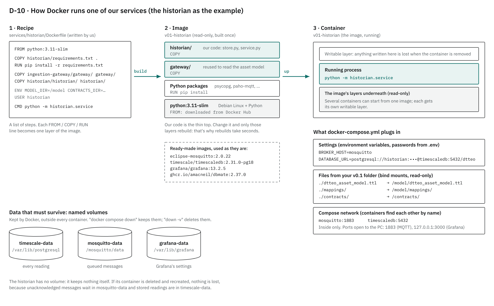
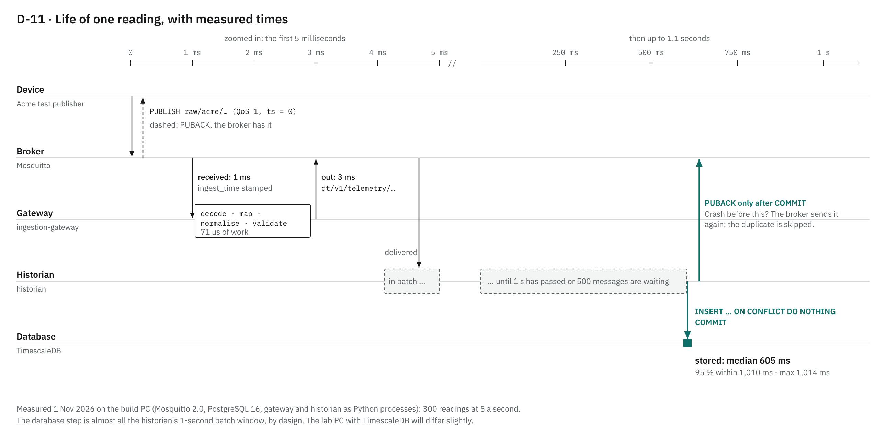
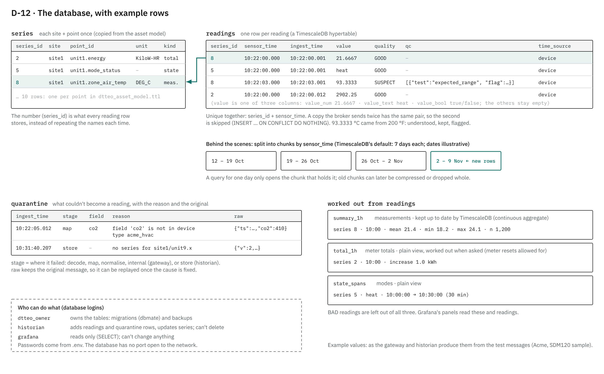

# How v0.1 works: a walkthrough and review

*1 November 2026, after stage 3 and the quick fixes. Read [`GUIDE.md`](GUIDE.md) first. This page doesn't repeat what's already written; where something is explained elsewhere, it links there.*

1. [The parts at a glance](#1-the-parts-at-a-glance)
2. [Docker, in our stack](#2-docker-in-our-stack)
3. [Life of one reading, timed](#3-life-of-one-reading-timed)
4. [The database](#4-the-database)
5. [Every file, and what it represents](#5-every-file-and-what-it-represents)
6. [Measured](#6-measured)
7. [Review: what's solid, what to watch](#7-review-whats-solid-what-to-watch)

---

## 1. The parts at a glance

| Part | In plain words | Runs as (container) | Explained in |
|---|---|---|---|
| **Broker** (Mosquitto) | The post office. Everything is sent to a named topic; whoever subscribed gets a copy. Holds messages for services that are away | `v01-mosquitto` | GUIDE §5, [`contracts/topics.md`](contracts/topics.md) |
| **Ingestion gateway** | The front door. Turns each device's own format into the one standard message, checks it, flags quality | `v01-gateway` | GUIDE §3, [`services/ingestion-gateway/NOTES.md`](services/ingestion-gateway/NOTES.md) |
| **Asset model + mappings** | The dictionary. Says what each point *is* (a zone temperature, in °C) and which device field feeds it | Files read by the gateway and historian | GUIDE §5–6, [`mappings/DESIGN.md`](mappings/DESIGN.md) |
| **Contracts** | The agreements. The exact shape of every message, as machine-checkable files | Files read by tests and the historian | [`contracts/NOTES.md`](contracts/NOTES.md) |
| **Historian** | The filing clerk. Writes every message into the database, never losing or doubling one | `v01-historian` | [`services/historian/NOTES.md`](services/historian/NOTES.md) |
| **Database** (PostgreSQL + TimescaleDB) | The archive. Readings, quarantine, and summaries worked out from them | `v01-timescaledb`, set up by `v01-migrate` | §4 below, [ADR-001](decisions/ADR-001-time-series-store.md), [ADR-002](decisions/ADR-002-database-layout.md) |
| **Grafana** | The window. Dashboards that read the database | `v01-grafana` | [`storage/NOTES.md`](storage/NOTES.md) (stage 3c) |
| **Test publishers** (Acme, Borealis) | Made-up devices that send their own formats, so the gateway has something to translate | `v01-acme` / `v01-borealis` (one at a time) | [`testing/vendors/NOTES.md`](testing/vendors/NOTES.md) |
| **Tools** | Smoke test (is the whole stack working?), backup, sources index | Run by hand | GUIDE §9 |

---

## 2. Docker, in our stack



The four words that matter, in Docker's own terms:

- **Image:** "a standardized package that includes all of the files, binaries, libraries, and configurations" a program needs. Images are "immutable" and "composed of layers" ([Docker: what is an image?](https://docs.docker.com/get-started/docker-concepts/the-basics/what-is-an-image/)). We build three from `Dockerfile` recipes (gateway, historian, test publishers) and download the rest ready-made.
- **Container:** an image, running. It's an isolated process with its own small writable layer on top, and "data written to the container layer doesn't persist when the container is destroyed" ([Docker: storage](https://docs.docker.com/engine/storage/)).
- **Volume:** storage that outlives containers, "managed by the Docker daemon" (same page). Ours hold the database, the broker's queue and Grafana's settings.
- **Bind mount:** a file or folder from your PC shown inside a container. We use them read-only for config: the asset model, mappings, contracts, `mosquitto.conf`, the dashboard.

**`docker-compose.yml`** describes all nine services in one file, so one command starts them together, on one private network where they find each other by name (`mosquitto`, `timescaledb`). **`.env`** holds the passwords; Compose fills them in.

### The nine services

| Service | Image | Starts with `up`? | Keeps data in | Files from v0.1 (read-only) | Port on the PC |
|---|---|---|---|---|---|
| `mosquitto` | `eclipse-mosquitto:2.0.22` | yes | volume `mosquitto-data` | `broker/mosquitto.conf` | 1883 |
| `gateway` | built: `services/ingestion-gateway/Dockerfile` | yes | – | asset model, `mappings/` | – |
| `timescaledb` | `timescale/timescaledb:2.31.0-pg18` | yes | volume `timescale-data` | `storage/init/10_users.sh` | – |
| `migrate` | `ghcr.io/amacneil/dbmate:2.37.0` | yes, then exits | – | `storage/migrations/` | – |
| `historian` | built: `services/historian/Dockerfile` | yes, after `migrate` succeeds | – | asset model, `mappings/`, `contracts/` | – |
| `grafana` | `grafana/grafana:13.2.5` | yes | volume `grafana-data` | `grafana/provisioning/`, `grafana/dashboards/` | 127.0.0.1:3000 |
| `acme` / `borealis` | built: `testing/vendors/Dockerfile` | only with `--profile acme` / `borealis` | – | – | – |
| `backup` | `timescale/timescaledb:2.31.0-pg18` | only by `docker compose run --rm backup` | writes to `v0.1/backups/` | `storage/backup.sh` | – |

How start-up order is enforced (`depends_on`): `migrate` waits until the database is **healthy** (its `pg_isready` check passes); the historian waits until `migrate` has **"run to successful completion"**, so the tables exist before anything is written ([Docker: startup order](https://docs.docker.com/compose/how-tos/startup-order/)). A service with a **profile** "is ignored by Compose when none of the listed profiles match the active ones" ([Docker: profiles](https://docs.docker.com/reference/compose-file/profiles/)): that's how only one test vendor runs at a time.

### The commands, and what each does

| Command (from `v0.1`) | What happens |
|---|---|
| `docker compose up -d --build` | Rebuilds images whose recipe or code changed, then starts every service without a profile, in the background (`-d`) |
| `docker compose --profile acme up -d` | Same, plus the Acme test publisher |
| `docker compose logs -f historian` | Follow one service's log |
| `docker compose exec timescaledb psql -U dtteo_owner -d dtteo` | Run a command inside a running container (here: an SQL prompt) |
| `docker compose run --rm backup` | Start a one-off container, run it, delete it |
| `docker compose restart grafana` | Restart one service; its volume and files are untouched |
| `docker compose down` | Stop and remove the containers. **Volumes stay** (data is kept) |
| `docker compose down -v` | Same, **and delete the volumes**: database, broker queue, Grafana settings. A true clean start |

---

## 3. Life of one reading, timed



What the *data* looks like at each step is in [D-04](diagrams/data_flow.png) (GUIDE §4); this picture is about *time* and *who confirms what*.

- **PUBACK** is MQTT's "got it". With QoS 1, the sender keeps a message until it gets one, and re-sends if it doesn't. That's why a duplicate is possible, and why the database skips copies.
- The gateway's own work is tiny (71 µs per message). Most of the 3 ms is passing through the broker twice.
- The historian deliberately waits up to 1 s to save in batches, then acknowledges only after the database has committed. That ordering is what makes a crash safe ([ADR-002 §7](decisions/ADR-002-database-layout.md)).

---

## 4. The database



The design reasons are in [ADR-002](decisions/ADR-002-database-layout.md); the files that create it are listed in [`storage/NOTES.md`](storage/NOTES.md). In short: `series` names each point once; `readings` stores one row per reading, pointing to it by number; `quarantine` keeps what couldn't be stored, with the reason and the original; the summaries are worked out from `readings`.

---

## 5. Every file, and what it represents

Grouped by what kind of thing each file is. (Build notes, `.pytest_cache`, `venv` and `__pycache__` are left out.)

**Code: what runs**

| Path | Represents |
|---|---|
| `services/ingestion-gateway/gateway/decoders/` | One reader per device format: `acme.py`, `borealis.py` (made-up), `tasmota.py`, `modbus.py` (real formats) |
| `…/gateway/mapper.py` | Reads the asset model and mappings into a lookup table: (device, field) → point |
| `…/gateway/normaliser.py`, `units.py` | Converts to standard form: units (via QUDT factors), UTC times, value maps |
| `…/gateway/validator.py` | Quality flags (GOOD / SUSPECT / BAD) and their reasons |
| `…/gateway/pipeline.py` | Joins the steps: one raw message in → messages out. No MQTT inside, so it's testable alone |
| `…/gateway/service.py` | The MQTT side of the gateway: connect, subscribe, publish |
| `…/gateway/demo.py` | Prints what the gateway makes of the sample messages |
| `services/historian/historian/store.py` | Messages → database rows (the "historian interface") |
| `services/historian/historian/service.py` | The MQTT side: batches, acknowledgements, retries |
| `testing/vendors/*_publisher.py` | The two made-up devices |
| `tools/smoke_test.py`, `tools/list_sources.py` | End-to-end check; rebuilds `SOURCES.md` |

**Configuration: how things run**

| Path | Represents |
|---|---|
| `docker-compose.yml` | The whole stack: services, images, volumes, mounts, ports, start-up order |
| `.env.example` → `.env` | Passwords (`.env` is never committed) |
| `*/Dockerfile`, `*/requirements*.txt`, `.dockerignore` | Image recipes and the Python packages they install (`-dev` = test tools, PC only) |
| `broker/mosquitto.conf` | Broker settings: listener, persistence, queue size (logins next) |
| `config/retention.yaml` | How long each kind of data is kept (feasibility: everything) |
| `grafana/provisioning/` | Grafana's database connection, and where to find dashboards |
| `.gitignore`, `.gitattributes` | What git ignores; Unix line endings for shell scripts |

**Agreements and meaning: what the data is**

| Path | Represents |
|---|---|
| `contracts/*.schema.json` | The canonical and quarantine message shapes |
| `contracts/topics.md` | Which topic carries what, who may publish and subscribe |
| `contracts/examples/` | Messages that must pass / must fail the shape check |
| `dtteo_asset_model.ttl` | The site, unit, zone and its 10 points (Brick vocabulary): what each point is, its unit, kind and expected range |
| `mappings/types/*.ttl` | One file per **model** of device: what it sends |
| `mappings/bindings/site1.ttl` | One entry per **installed** device: its type, what it serves, on or off |
| `mappings/dtteo_onboarding.ttl`, `dtteo_ref.ttl` | The vocabulary those files use |
| `mappings/acme.ttl`, `borealis.ttl` | Empty since step 2e (content moved into `types/` and `bindings/`); safe to delete |

**Database definitions**

| Path | Represents |
|---|---|
| `storage/migrations/*.sql` | The schema, one change per file, in order |
| `storage/init/10_users.sh` | Creates the `historian` and `grafana` logins on the database's first start |
| `storage/backup.sh` | One backup into `backups/` |
| `grafana/dashboards/dtteo-overview.json` | The dashboard (master copy) |

**Tests and samples**: `services/*/tests/` (test files), `services/ingestion-gateway/tests/samples/` (one recorded message per format), `pytest.ini` (tells pytest where the code is).

**Docs and pictures**: `GUIDE.md` (start here), `README.md` (full design), this page, `SOURCES.md` (generated), `decisions/` (ADRs), `*/NOTES.md` (build logs, newest at the bottom), `diagrams/` (D-01 to D-12; editable sources in `diagrams/src/`).

---

## 6. Measured

On the build PC, 1 November 2026: local Mosquitto 2.0, PostgreSQL 16 (TimescaleDB couldn't be installed there), the gateway and historian as Python processes. The lab PC will differ somewhat; the commands at the end measure it there.

| What | Result | What it means |
|---|---|---|
| Tests | Gateway **120**, historian **16**, contract examples **10**, smoke test **6 checks** (all passing; smoke test run on the lab PC 31 Oct) | |
| Publish → gateway receives | median **1 ms**, max 16 ms | 300 readings at 5/s |
| Publish → canonical message out | median **3 ms**, 95 % ≤ 4 ms | |
| Publish → row in the database | median **605 ms**, max 1,014 ms | The 1 s batch window, by design |
| Gateway pipeline speed | **14,000** messages/s (71 µs each) | The rig makes ~0.2/s (ADR-001): huge headroom |
| Historian write speed | **7,000** readings/s with the contract check, 19,000 without | The per-message contract check is two-thirds of the cost; irrelevant at our rates |
| Database outage | Historian held **1,000** messages (the MQTT 5 Receive Maximum), then stored all 3,000 | Nothing lost; memory bounded |
| Storage per reading | **141 bytes** (109 table + 32 index), plain PostgreSQL | ADR-001 estimated 88. So the rig is ~0.75 GB/year, not 0.5. Still small |
| Storage per quarantine row | **376 bytes** | Acme humidity at one row per 3 s would have been ~4 GB/year: why step 2l counts it instead |
| Memory | Gateway ~41 MB, historian ~59 MB, Mosquitto ~7 MB | Python processes; containers will be similar |
| Start-up: asset model + mappings | 233 ms | |
| Code | Gateway 1,379 lines, historian 413, SQL 176, Turtle 529 (non-blank) | Docs: about 28,700 words |

**On the lab PC** (from `v0.1`, stack running):

```bat
docker compose ps
docker stats --no-stream
docker system df
docker compose exec timescaledb psql -U dtteo_owner -d dtteo -c "SELECT count(*) AS readings, pg_size_pretty(hypertable_size('readings')) AS size, round(hypertable_size('readings')::numeric / greatest(count(*),1)) AS bytes_each FROM readings"
```

---

## 7. Review: what's solid, what to watch

**Solid**

- **Nothing is lost silently, and that's been shown, not just designed.** Outage, restart and broker-restart tests all passed. Today's run even delivered a message from a test on 31 Oct that the broker had kept on disk for the historian's session.
- **Swappable where it matters.** New device = one type file + one binding (plus a decoder only for a new format); new database = one class behind the historian interface; the asset model drives the mapping, not hard-coded names.
- **Checked agreements.** Every message is checked against its contract in tests, and again by the historian before storing.
- **Least privilege in the database.** Grafana can only read; the historian can't delete; the database has no open port.
- **Repeatable.** Every image is pinned to an exact version; the schema is built by numbered migrations.

**To watch** (most important first)

| # | Point | Why it matters | Plan |
|---|---|---|---|
| 1 | Broker accepts anyone | Anyone on the lab network could publish fake device data | **Next stage** (GUIDE §12) |
| 2 | Test data isn't realistic | Acme swings 6 °C in 40 s: fine for the pipeline, useless for a twin | Stage 4: simulated plant |
| 3 | Real storage is ~1.6× ADR-001's estimate | Sizing claims for the grant should use measured numbers | Noted in ADR-001 §2; re-measure on the lab PC (command above) |
| 4 | No service watches health | Gateway and historian announce `online`/`offline` on `dt/v1/status/…`, but nothing records or alerts on it; Docker restarts crashed containers, silently | Store status in the database and show it in Grafana, with the detection stage |
| 5 | Summaries re-check only the last 7 days | A back-fill older than that needs one manual refresh | Written in `storage/NOTES.md`; the CSV importer will do it automatically |
| 6 | Gateway-stamped times | A re-sent message from a device with no clock is stored twice | Known (step 2i); devices we control send their own time |
| 7 | Real hardware untested | Tasmota and SDM120 are tested on recorded samples only; no Modbus poller yet | When the ESP8266 is connected (after broker logins) |
| 8 | Sessions catch up | If the historian is stopped during a test, it stores those messages when it next starts, possibly days later | Expected behaviour; worth knowing when reading test data |
| 9 | Docs outweigh code | ~28,700 words for ~1,800 lines of service code | Start from GUIDE and this page; NOTES stay as build logs; new entries short |
| 10 | Minor | Python base image tag (`3.11-slim`) moves with patch releases; logs live only in `docker compose logs` | Fine for feasibility; pin before pilot |
