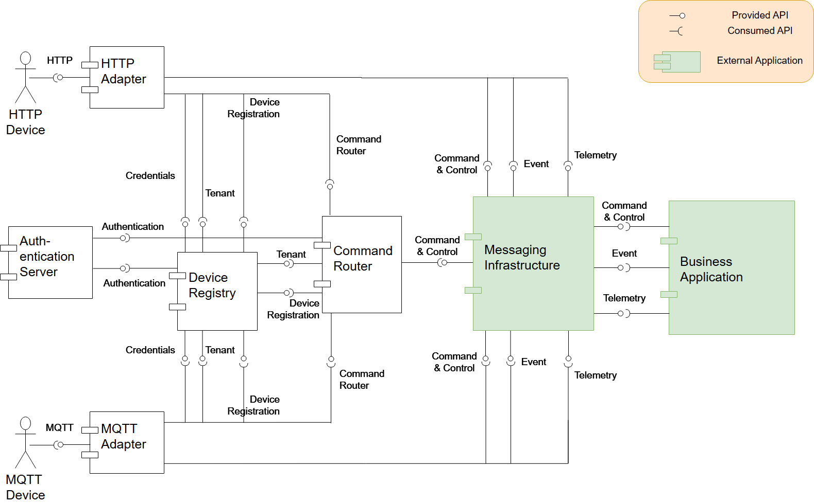
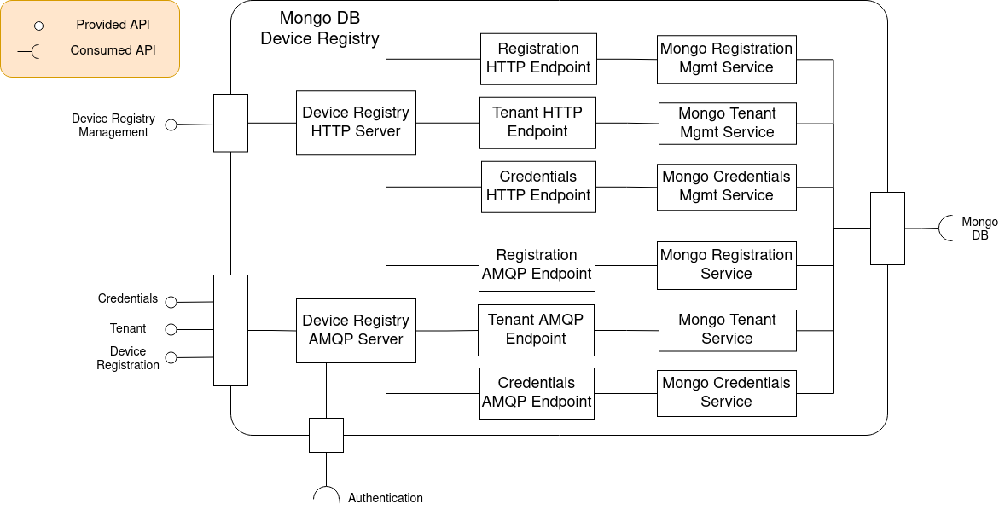
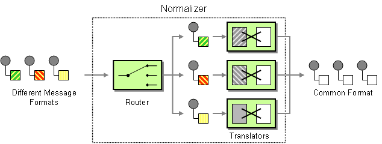
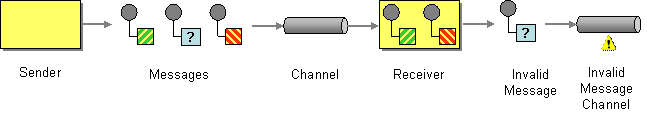
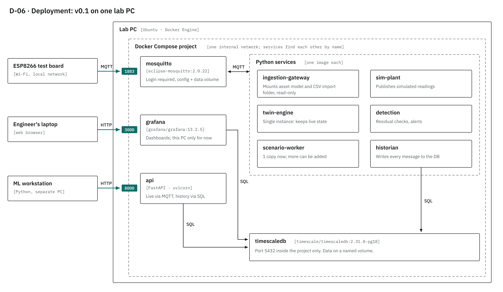
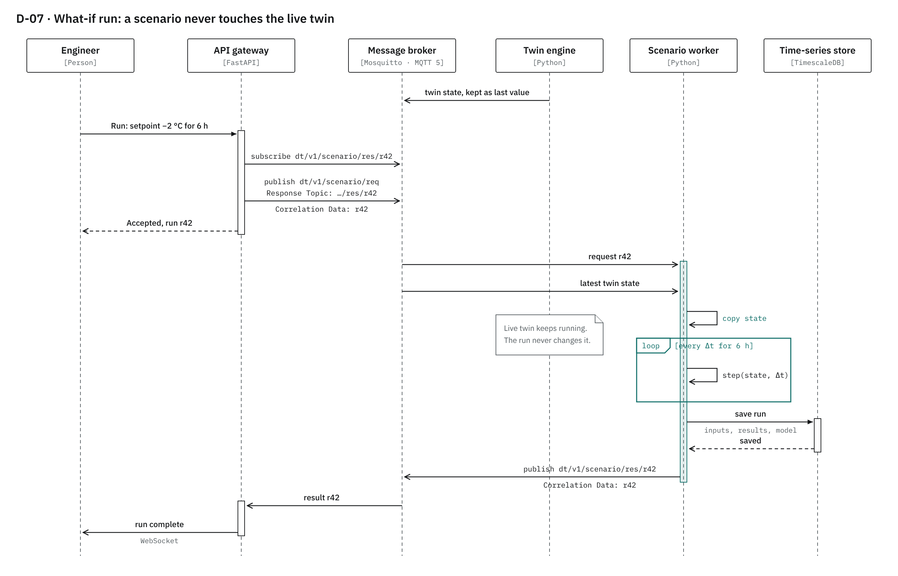
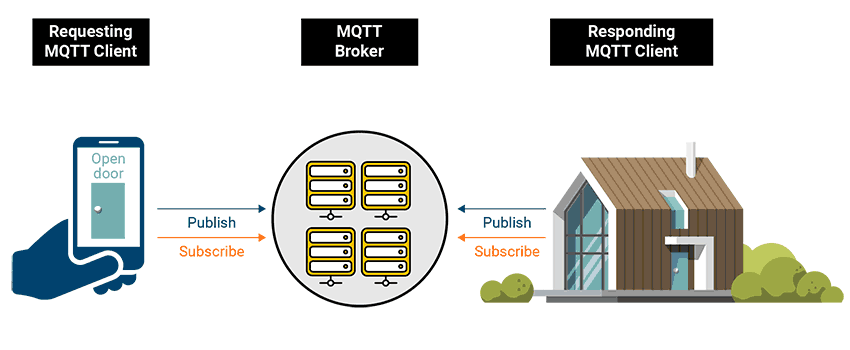

# DT-TEO v0.1: Digital Twin Foundation

**Status:** proposal and prototyping · **Last updated:** 28 October 2026

**New here?** Start with [`GUIDE.md`](GUIDE.md): a short guide to what is built so far and how to use it. This README is the full design.

This folder records the first stage of the DT-TEO digital twin: a proposed pipeline that can be tested quickly now and scaled later. Nothing here is locked in. The aim is a **modular, safe foundation** where sensors, data sources, models and storage can all be swapped without rewriting everything downstream.

There is no real building or site in this stage. Data comes from a simulated plant, recorded CSV files and a test board (ESP8266), so the whole pipeline can be built and tested on one PC.

---

## Contents

1. [What's in this folder](#whats-in-this-folder)
2. [Design principles](#design-principles)
3. [System context](#1-system-context)
4. [Architecture and the main parts](#2-architecture-and-the-main-parts)
5. [Ingestion gateway](#3-ingestion-gateway)
6. [Data flow: one reading, end to end](#4-data-flow-one-reading-end-to-end)
7. [Semantic layer and asset model](#5-semantic-layer-and-asset-model)
8. [Deployment](#6-deployment)
9. [What-if runs](#7-what-if-runs)
10. [Later phases](#later-phases)
11. [Open questions](#open-questions)
12. [References](#references)

---

## What's in this folder

| File | What it is |
|---|---|
| `README.md` | This document |
| `GUIDE.md` | Short, practical guide to what is built and how to use it |
| `decisions/` | Architecture decision records (ADRs): ADR-001 time-series store (accepted), ADR-002 database layout (proposed) |
| `config/retention.yaml` | How long each kind of stored data is kept (ADR-001 section 9) |
| `architecture.png` | Reference table of standard IoT architecture layers |
| `dtteo_asset_model.ttl` | Starting asset model (Brick schema) for one placeholder heat/cool unit |
| `diagrams/system_context.png` | D-01 · what the platform exchanges data with |
| `diagrams/container_view.png` | D-02 · the main services inside the platform |
| `diagrams/ingestion_gateway.png` | D-03 · how any data source becomes one standard message |
| `diagrams/data_flow.png` | D-04 · how one reading changes shape step by step |
| `diagrams/asset_model.png` | D-05 · the semantic model of the unit and its sensors |
| `diagrams/deployment_images.png` | D-06 · how v0.1 runs on one lab PC |
| `diagrams/what_if.png` | D-07 · how a scenario run works without touching the live twin |
| `diagrams/onboarding.png` | D-09 · how a device type, a binding and the asset model give each field its point |
| `diagrams/normalizer.png`, `invalid_message.png`, `logical_components.png`, `device_registery.png`, `MQTT_5_Request_Response.png` | Reference images from external docs, credited where they are used |

---

## Design principles

These come from earlier project decisions and guide every part below.

- **Adapters at the edge.** Anything vendor- or device-specific is handled in one place, the ingestion gateway. Everything after it sees one standard message format, so adding a sensor or source never changes downstream code.
- **Semantic data from day one.** Every reading is linked to a description of what it is (a zone temperature, measured in °C, for unit 1). Without this, the data becomes hard to use for anything meaningful later, especially ML.
- **A physics-based twin, checked against reality.** The twin predicts what should happen. The gap between prediction and measurement, called the **residual**, is the main output and what anomaly detection watches.
- **Read-only first.** v0.1 only observes; it doesn't control equipment. In the terms of Kritzinger et al. (2018), that makes it a *digital shadow* (data flows one way). Two-way control comes later, with its own safety design.
- **Scale before sophistication.** Use simple, proven tools now (one PC, Docker Compose) and keep each part swappable so it can grow.
- **Avoid lock-in.** Prefer open standards and open-source tools, and keep each choice behind an interface so it can change.

---

## 1. System context


This is the "zoomed-out" view. The whole platform is a single box, and everything around it is something it exchanges data with. It is drawn using the [C4 model](https://c4model.com/diagrams/notation), a common way to draw software architecture at different zoom levels: context → containers → components.

**Inputs (left)**
- **Simulated plant:** generates realistic test data and can inject faults on purpose. It is deliberately a slightly *different* model from the twin, so the twin isn't just checking itself.
- **Historical data files:** CSV exports, e.g. from a building management system.
- **Field devices:** real hardware. Today that's an ESP8266 test board; later it could be controllers using Modbus or OPC UA.
- **Forecast services (dashed, later):** weather and energy prices for better predictions.

**Outputs (right)**
- **Engineer:** monitors dashboards and runs what-if scenarios.
- **ML workstation:** a separate PC that receives clean, labelled history for training models, so heavy training never slows the live twin.
- **Heat/cool equipment (dashed, later):** receives control settings once two-way control is designed.

---

## 2. Architecture and the main parts

### Standard IoT layers


*Source: [WZ-IT – IoT architecture layers](https://wz-it.com/en/knowledge/iot/iot-architecture-layers/)*

Most IoT and digital twin systems follow a similar stack: devices → connectivity → edge/gateway → platform → storage → visualisation → integration. DT-TEO follows the same pattern. The main difference is that our "platform" layer contains the physics-based twin and detection, rather than a general-purpose IoT platform such as ThingsBoard.

### Container view


This zooms inside the platform box from the context diagram. Each box is a separate service (a **container**) that could run, restart or be replaced on its own.

The key idea is the **message broker** in the middle (highlighted). Services don't call each other directly. They publish messages to named topics on the broker, and any service interested in a topic subscribes to it. Adding a new service, such as an ML model, just means subscribing it to the right topic; nothing else changes.

| Service | What it does | Technology (proposed) |
|---|---|---|
| Ingestion gateway | The front door. Turns every source into the standard message. See [section 3](#3-ingestion-gateway). | Python |
| Asset model | Describes every sensor point and how equipment connects. See [section 5](#5-semantic-layer-and-asset-model). | Turtle file, Brick schema |
| Message broker | Passes messages between all services | Mosquitto, MQTT 5 |
| Twin engine | Runs the physics model (RC thermal model + observer), predicts the next state, compares it with measurements | Python |
| Detection & alerts | Watches the residual for anomalies (EWMA, CUSUM, Z-score) and raises alerts | Python |
| Scenario worker | Runs what-if scenarios and ML predictions on a copy of the twin state | Python |
| Historian | Records every message to the database | Python |
| Time-series store | Keeps telemetry, twin state, alerts and run history | TimescaleDB (PostgreSQL) |
| API gateway | Gives the UI live updates and history in one place | FastAPI (REST + WebSocket) |
| Web UI | Dashboards and what-if forms | Grafana, React |

> **How MQTT works (quick primer).** MQTT is a lightweight publish/subscribe protocol designed for IoT. A device *publishes* a message to a *topic* such as `site1/unit1/telemetry`. Anything *subscribed* to that topic gets a copy, routed by the broker. Publishers and subscribers never need to know about each other. See also `../mqtt-pipeline/README.md`.

This layout lines up with two published references:
- **ISO 23247** (digital twin framework for manufacturing) splits a twin into a *data collection* entity, the *digital twin* entity and the *user* entity. That maps to our ingestion gateway, our twin/detection/scenario services, and our API and UI. See [this case study using ISO 23247](https://arxiv.org/pdf/2508.18662).
- **[OpenTwins](https://arxiv.org/pdf/2301.05560)** is an open-source twin framework with the same overall shape: devices feed a central twin service, events go to a separate time-series database, and predictions are written to a copy of the twin.

---

## 3. Ingestion gateway


The ingestion gateway is what makes the rest of the system swappable. Each data source gets a small **adapter**, and every adapter feeds the same **shared pipeline**, which is written once and driven by configuration.

**Rule:** the gateway *translates and checks*; it never *interprets*. Averaging, fault detection and decisions belong to the twin and its models, not here.

### Protocol adapters

There is one small plug-in per type of source:

| Adapter | Source | How it gets data |
|---|---|---|
| MQTT adapter | ESP8266, IoT sensors | **Push:** the device sends messages when it wants |
| File adapter | CSV exports | Reads files in chunks, so large files don't fill memory |
| Modbus poller | Meters, heat pumps, controllers | **Pull:** asks the device for numbered "registers" on a timer |

Adding a new protocol later (OPC UA, BACnet, a vendor API) means writing one new adapter, and nothing after it changes. Built so far (October 2026): the MQTT side, with decoders for two made-up test vendors (`testing/vendors/`) and two real formats, Tasmota and the Eastron SDM120 Modbus meter (`mappings/types/`). The Modbus poller and CSV importer are still to come. See `GUIDE.md`.

The same pattern is used by **Eclipse Hono**, an open-source IoT connectivity project. Hono has a separate adapter for each protocol; each adapter checks the device against a registry, then hands data to the messaging layer.



*Source: [Eclipse Hono – Component view](https://eclipse.dev/hono/docs/architecture/component-view/). HTTP and MQTT adapters both check the Device Registry, then pass telemetry to the messaging infrastructure.*

### Mapper

The mapper turns a device's own name for a reading (e.g. `t1`) into our standard point ID (e.g. `unit1.zone_air_temp`) by looking it up in the **asset model**. The asset model plays the same role as Hono's Device Registry: one place that knows what each device and reading is.



*Source: [Eclipse Hono – Component view](https://eclipse.dev/hono/docs/architecture/component-view/). Hono's registry stores device registrations, tenants and credentials. Ours stores point definitions and their meaning.*

### Normaliser

Every source formats data differently: scaled integers, different units, local clocks. The normaliser converts everything into one common shape: SI units (°C, kW), UTC timestamps and sensible rounding.

This is the **Normalizer** pattern from *Enterprise Integration Patterns*: a router sends each format to its own translator, and every translator outputs the same common format.



*Source: [Enterprise Integration Patterns – Normalizer](https://www.enterpriseintegrationpatterns.com/patterns/messaging/Normalizer.html) (Hohpe & Woolf).*

### Validator

The validator checks each reading: is it within what the sensor can measure, within what we expect at that point, and did it arrive with a believable time? It then adds a **quality flag** (`GOOD`, `SUSPECT` or `BAD`) and, if not GOOD, the reasons (`qc`). Readings aren't silently "fixed"; they are labelled, so later steps can decide what to do with them. Checks that need a point's history (spikes, stuck sensors) come after storage.

### Quarantine

Readings that can't be processed aren't dropped. They go to a separate **quarantine topic** where they can be inspected later, with the original message and the reason (`contracts/quarantine_message.schema.json`). Three cases send a reading there:
- the message **can't be read** at all (e.g. not valid JSON);
- an **unknown point**: a field nobody has mapped yet (a field the device type marks *optional* and the asset model deliberately has no point for is counted in the gateway log instead, once a minute);
- a value that **can't be converted** (e.g. a mode word not in the value map).

A reading that was understood but fails a validator check is **not** quarantined: it is published with quality `SUSPECT` or `BAD`, and a `qc` list saying which check flagged it, so nothing is lost and the flag can be revisited (steps 2g, 2i). A fourth case, a bug in the gateway itself, also quarantines the message (stage `internal`) rather than losing it (step 2j).

Registering the point in the asset model releases future readings normally. This is the **Invalid Message Channel** pattern:



*Source: [Enterprise Integration Patterns – Invalid Message Channel](https://www.enterpriseintegrationpatterns.com/patterns/messaging/InvalidMessageChannel.html) (Hohpe & Woolf).*

### Publisher

The publisher sends the finished **canonical message** to the broker over MQTT 5. It also holds a small buffer, so a short broker outage doesn't lose data, and logs an error if that buffer ever fills. The broker itself saves queued messages to disk, so a broker restart doesn't lose them either (`broker/mosquitto.conf`, step 2j).

### Scaling the gateway later

- Adapters are **stateless** (they keep nothing important in memory), so several copies can run side by side.
- MQTT 5 **shared subscriptions** let several copies of a service share the incoming messages; the broker hands each message to just one of them.
- For v0.1 a single instance is enough.

---

## 4. Data flow: one reading, end to end


This follows one example temperature reading and shows **the actual data** at each step. Teal text marks what each step adds or changes.

1. **Device sends a reading:** `{"t1": 2152, "ts": 1791979200}`. It is raw and device-specific, with a scaled number and the device's own clock.
2. **Gateway decodes it** into a standard record and adds `ingest_time`, the moment we received it. A CSV row joins in here in the same shape.
3. **Matched and normalised:** `t1` is looked up in the asset model and becomes `unit1.zone_air_temp`. `2152 × 0.01` gives `21.52 °C`, and the device clock becomes UTC. An unknown name goes to quarantine.
4. **Checked and published** as the canonical message (below). This is the only shape the rest of the system ever sees.
5. **Compared with the twin's prediction:** predicted 21.30, measured 21.52, **residual +0.22 K**. Detection watches the residual.
6. **Stored** in the time-series database for history and ML.

**Bulk history** (e.g. a big CSV import) goes through the same checks but **skips the twin**; it is only stored. This is the common *hot path / cold path* split in IoT systems: live data is processed immediately, and history is processed in batches ([Atmosera – Azure IoT reference architecture](https://www.atmosera.com/blog/an-azure-iot-reference-architecture-for-azure/)).

### The canonical message

```json
{
  "v": 2,
  "site": "site1",
  "point": "unit1.zone_air_temp",
  "value": 21.52,
  "unit": "DEG_C",
  "sensor_time": "2026-10-14T12:00:00.000Z",
  "ingest_time": "2026-10-14T12:00:00.400Z",
  "time_source": "device",
  "source": "acme:acme_hvac_0001",
  "quality": "GOOD"
}
```

| Field | Why it's there |
|---|---|
| `v` | Schema version, so the format can change later without breaking old data (v2 since step 2i) |
| `site` | Which site; `site` + `point` identifies a reading uniquely across sites |
| `point` | Standard point ID; links to the asset model |
| `value`, `unit` | The reading, and its unit as a QUDT ID (e.g. `DEG_C`, `KiloW`) |
| `source` | Optional: which format and device it came from, for tracing |
| `sensor_time` | When it was **measured**, called "event time" |
| `ingest_time` | When we **received** it, called "processing time" |
| `time_source` | `device` if the device sent the time, `gateway` if we had to use the arrival time |
| `quality` | Set by the validator |
| `qc` | Only when not GOOD: which checks flagged it, and why |

**Why two timestamps?** Data can arrive late, out of order or replayed from a file. Keeping the time it was measured (event time) separately from the time it arrived (processing time) keeps results correct regardless of arrival order. See [Apache Flink – Timely stream processing](https://ci.apache.org/projects/flink/flink-docs-master/docs/concepts/time/).

The message is intentionally small and has no "meaning" inside it. Meaning lives in the asset model, linked by `point`. Its shape is close to the IETF standard for sensor readings, [SenML (RFC 8428)](https://datatracker.ietf.org/doc/rfc8428/), and the full message contract can be written down using [AsyncAPI](https://asyncapi.com/docs/concepts/asyncapi-document), effectively "OpenAPI for MQTT".

---

## 5. Semantic layer and asset model


### What "semantic data" means

A number like `21.5` means nothing on its own. Semantic data is the **data about the data**: what it measures, its unit, where it is and what it's connected to. It is stored as a small **graph**, where things are nodes and relationships are arrows, for example:

> Heat/cool unit → **feeds** → HVAC zone → **hasPoint** → Zone air temperature sensor

Software can then *ask questions* of the model, such as "give me the zone temperature for every zone this unit feeds", instead of relying on hard-coded IDs. That is what lets models and sources be swapped later.

### Two layers, linked by ID

Mature systems keep two things separate:
1. **Telemetry:** fast, high-volume readings (the canonical message).
2. **The semantic model:** slow-changing descriptions of points and equipment.

Each point in the model **points to** its time-series ID (the highlighted box in the diagram). Brick does this with `ref:hasExternalReference` → `ref:TimeseriesReference` → `ref:hasTimeseriesId`. That ID is the same `point` value as in the canonical message.

### The starting model: `dtteo_asset_model.ttl`

The asset model file describes one **placeholder** heat/cool unit serving one zone, with ten points: requested and reported mode, heating output, cooling output, electrical power, electrical energy (meter total), supply air temperature, zone air temperature, zone setpoint and outside temperature. Each point says what **kind** of value it is (`measurement`, `total` or `state`), so storage knows how to summarise it (step 2k). It is written in **Turtle** (`.ttl`), a plain-text format for graphs, using the **[Brick schema](https://github.com/BrickSchema/Brick)**.

- All class and relationship names were checked against Brick 1.5 using the [`brickschema` Python library](https://brickschema.readthedocs.io/en/stable/), and the model validates with no errors.
- Newer Brick versions move Site, Building, Room and HVAC Zone into the **RealEstateCore** vocabulary, which is why they appear as `rec:` classes.
- Relationships follow the [Brick relationships guide](https://docs.brickschema.org/brick/relationships.html):
  - `feeds` runs from upstream to downstream;
  - `hasPoint` runs from equipment to its sensors;
  - `hasPart` means containment;
  - `hasLocation` means physical placement.

**To add a sensor:**
1. Add a point node with its Brick class and unit.
2. List it under the equipment's `brick:hasPoint`.
3. Give it a `ref:hasTimeseriesId` matching the point ID the gateway publishes.
4. Give it a `dtteo:valueKind` (`"measurement"`, `"total"` or `"state"`).
5. Re-run validation (and `python -m gateway.mapper`, which refuses to start if the kind is missing):

```bash
python -c "import brickschema as b; g=b.Graph(load_brick=True); g.load_file('dtteo_asset_model.ttl'); print(g.validate()[2])"
```

When Botanic's real unit is specified, replace `brick:Packaged_Heat_Pump` with the right class and update the points. Only this file and the simulated plant need to change.

### Why Brick, and what else is out there

| Standard | In plain terms | Fit for v0.1 |
|---|---|---|
| [Brick](https://github.com/BrickSchema/Brick) | Dictionary of building equipment and sensor types, plus rules for how they connect | **Used now.** Open (BSD), with Python tooling |
| [Project Haystack](https://marketing.project-haystack.org/project-haystack-media/press-releases/project-haystack-unveils-haystack-5-with-xeto-schema-language-and-rdf-integration-at-haystack-connect-2025) | Tags on points (`temp`, `zone`, `sensor`); widely used commercially | Brick can import Haystack models |
| [ASHRAE 223P](https://www.energy.gov/cmei/buildings/ashrae-standard-223p) | Formal successor merging Brick and Haystack ideas | Still in draft; [second public review April–June 2026](https://www.ashrae.org/file%20library/technical%20resources/standards%20and%20guidelines/standards%20actions/sa-apr_24_2026.pdf). Watch it. [Fraunhofer extended it to district heating](https://publica.fraunhofer.de/handle/publica/505644) |
| [SAREF / SAREF4ENER](https://arxiv.org/pdf/2609.04213) | European IoT device and energy vocabulary | Naming reference |
| [W3C SOSA/SSN](https://www.w3.org/TR/2026/WD-vocab-ssn-2023-20260909/) | General "sensor made an observation" pattern | Shapes the canonical message |
| [Asset Administration Shell](https://industrialdigitaltwin.org/?p=6954) | Industry 4.0 "digital datasheet" for a product | Later. Useful if Botanic ships a twin with its own equipment |
| [ETSI NGSI-LD](https://cim.etsi.org/NGSI-LD/official/introduction.html) | REST API and data models for "entities" (EU smart cities) | Possible export target later |
| [W3C WoT Thing Description 2.0](https://www.w3.org/news/2025/first-public-working-draft-web-of-things-wot-thing-description-2-0) | Machine-readable "how to talk to this device" card | Too early (working draft) |

A useful lesson from the literature: a [2026 review of operational twins](https://itcon.org/paper/2026/43) found about half had formal semantics, but fewer than a third actually *used* them to shape analytics or decisions. So the asset model must do real work: the twin should find its inputs by querying it, not by hard-coded IDs.

---

## 6. Deployment



This shows how v0.1 runs on **one lab PC** using Docker Compose. Docker Compose starts several containers together from one file. It is drawn as a [C4 deployment diagram](https://c4model.com/diagrams/deployment): machines and runtime environments are nested boxes, with the services inside them.

- **Only three ports are open to the outside** (highlighted): MQTT `1883` for devices, Grafana `3000` for the engineer and the API `8000` for the ML workstation.
- **The database is not exposed.** It uses port `5432` *inside* the project only. Inside Compose, services find each other by name, e.g. `timescaledb:5432` ([Docker Compose networking](https://docs.docker.com/compose/how-tos/networking/)).
- **The broker requires a login.** Since Mosquitto 2.0, a broker that accepts connections from other machines refuses anonymous clients by default ([Mosquitto 2.0 migration notes](https://mosquitto.org/documentation/migrating-to-2-0/)), so the ESP8266 needs a username and password.
- **Scaling:** the scenario worker can have extra copies added. The twin engine stays as one instance because it holds live state in memory.

### Storage: decided

The working prototype in the repo root (`../docker-compose.yml`) runs **InfluxDB 2.7**. v0.1 uses **PostgreSQL with the TimescaleDB extension** instead, **accepted on 19 October 2026** for the feasibility study ([`decisions/ADR-001-time-series-store.md`](decisions/ADR-001-time-series-store.md)), because:
- it handles the weeks-long queries that calibration and ML need;
- one database can hold telemetry, alerts, twin state and run history together;
- the application code uses standard SQL, so plain PostgreSQL remains a fallback if the TimescaleDB licence is rejected before commercial use.

How the tables, migrations, historian writes, access and backups work is proposed in [`decisions/ADR-002-database-layout.md`](decisions/ADR-002-database-layout.md).

---

## 7. What-if runs



A what-if run asks questions such as "what happens if the setpoint drops 2 °C for 6 hours?" **without touching the live twin**. The diagram is a [UML sequence diagram](https://uml-diagrams.org/sequence-diagrams-reference.html): time runs downward, and each column is a participant.

1. The engineer starts a run from the UI.
2. The API sends an **MQTT 5 request** to the scenario worker (explained below).
3. The worker takes a **copy** of the latest twin state.
4. It steps the copy forward in a loop (`step(state, Δt)`) for the scenario duration.
5. It saves the run (inputs, results, model version) so it can be repeated exactly.
6. It replies with the result, and the UI shows it.

The live twin keeps running and is never changed. OpenTwins uses the same idea, writing predictions to a copy of the twin rather than the main one. This is also where ML and step-ahead prediction models will plug in later.

### How MQTT 5 request/response works



*Source: [HiveMQ – MQTT 5 Request/Response pattern](https://www.hivemq.com/blog/mqtt5-essentials-part9-request-response-pattern/)*

MQTT is normally one-way. MQTT 5 adds two message properties that turn it into a request and a reply:
- **Response Topic:** "send your answer to this topic", e.g. `dt/v1/scenario/res/r42`.
- **Correlation Data:** an ID such as `r42`, so the requester knows which request an answer belongs to.

The requester subscribes to its reply topic *first*, then sends the request. The responder publishes the result to that topic and copies the same ID back.

---

## Later phases

These are deliberately **not** in v0.1:

- **Command path (D-08):** sending setpoints to real equipment. This needs its own safety design:
  - a hardware cut-out on the device;
  - firmware watchdogs;
  - an allow-list and audit log in a command service;
  - broker access rules.
- **Forecasts:** weather and price data as an extra input.
- **More protocols:** OPC UA, BACnet and real Modbus devices, each added as a new adapter.
- **Higher-fidelity plants:** BOPTEST (Docker-based virtual buildings) and FMU co-simulation, used as alternative "plants" behind the same adapter.
- **ML models:** forecasting and anomaly models, plugged into the scenario worker and prediction slot.
- **Visual twin:** connecting the existing 3D building demo to live data through the API gateway.

---

## Open questions

- What controller or interface will Botanic's own unit expose (Modbus, BACnet, proprietary)? This decides which adapter matters most.
- What are the real unit's inputs, outputs and modes? These will replace the placeholder in `dtteo_asset_model.ttl` and the simulated plant.
- Database layout (ADR-002): confirm the proposal before the historian is built.
- Should ESP8266 firmware be written in ESPHome (simpler) or Arduino (more control over messages)?
- When should the command path design (D-08) start?

---

## References

### Semantics and data models
- Brick Schema: <https://github.com/BrickSchema/Brick> · [Python docs](https://brickschema.readthedocs.io/en/stable/) · [Relationships](https://docs.brickschema.org/brick/relationships.html) · [Example server](https://github.com/BrickSchema/brick-example-server/blob/master/README.md)
- ASHRAE 223P, US DOE: <https://www.energy.gov/cmei/buildings/ashrae-standard-223p>
- ASHRAE Standards Actions, April 2026: <https://www.ashrae.org/file%20library/technical%20resources/standards%20and%20guidelines/standards%20actions/sa-apr_24_2026.pdf>
- 223P for district heating (Fraunhofer): <https://publica.fraunhofer.de/handle/publica/505644>
- Haystack 5 / Xeto: <https://marketing.project-haystack.org/project-haystack-media/press-releases/project-haystack-unveils-haystack-5-with-xeto-schema-language-and-rdf-integration-at-haystack-connect-2025>
- SAREF + Ditto paper (arXiv 2609.04213): <https://arxiv.org/pdf/2609.04213>
- W3C SOSA/SSN: <https://www.w3.org/TR/2026/WD-vocab-ssn-2023-20260909/>
- IDTA, Asset Administration Shell: <https://industrialdigitaltwin.org/?p=6954>
- ETSI NGSI-LD: <https://cim.etsi.org/NGSI-LD/official/introduction.html>
- W3C WoT Thing Description 2.0: <https://www.w3.org/news/2025/first-public-working-draft-web-of-things-wot-thing-description-2-0>
- Ontologies in Digital Twins (systematic review): <https://dare.uva.nl/id/1fd181f2-a16b-4e49-ae77-2e85a7789877>
- Operational DTs, semantic infrastructure review (ITcon 2026): <https://itcon.org/paper/2026/43>

### Messages and protocols
- SenML (RFC 8428): <https://datatracker.ietf.org/doc/rfc8428/>
- OGC SensorThings: <https://en.wikipedia.org/wiki/SensorThings_API>
- AsyncAPI: <https://asyncapi.com/docs/concepts/asyncapi-document>
- Unified Namespace: <https://tractian.com/en/glossary/unified-namespace>
- MQTT 5.0 specification (OASIS): <https://docs.oasis-open.org/mqtt/mqtt/v5.0/os/mqtt-v5.0-os.html>
- MQTT 5 request/response (HiveMQ): <https://www.hivemq.com/blog/mqtt5-essentials-part9-request-response-pattern/>
- Event time vs processing time (Apache Flink): <https://ci.apache.org/projects/flink/flink-docs-master/docs/concepts/time/>

### Architecture and patterns
- C4 model, [notation](https://c4model.com/diagrams/notation) · [container](https://c4model.com/diagrams/container) · [deployment](https://c4model.com/diagrams/deployment)
- ISO 23247-2: <https://www.iso.org/standard/78743.html> · [ISO 23247 case study (arXiv 2508.18662)](https://arxiv.org/pdf/2508.18662)
- OpenTwins (arXiv 2301.05560): <https://arxiv.org/pdf/2301.05560>
- Open-source IoT/DT platforms compared: <https://wz-it.com/en/knowledge/iot/open-source-iot-platforms-compared/>
- IoT architecture layers: <https://wz-it.com/en/knowledge/iot/iot-architecture-layers/>
- Eclipse Hono, component view: <https://eclipse.dev/hono/docs/architecture/component-view/>
- Enterprise Integration Patterns, [Normalizer](https://www.enterpriseintegrationpatterns.com/patterns/messaging/Normalizer.html) · [Invalid Message Channel](https://www.enterpriseintegrationpatterns.com/patterns/messaging/InvalidMessageChannel.html)
- Hot / warm / cold paths: <https://www.atmosera.com/blog/an-azure-iot-reference-architecture-for-azure/>
- UML sequence diagrams: <https://uml-diagrams.org/sequence-diagrams-reference.html>

### Deployment
- Docker Compose networking: <https://docs.docker.com/compose/how-tos/networking/>
- Mosquitto 2.0 migration: <https://mosquitto.org/documentation/migrating-to-2-0/>
- TimescaleDB with Docker: <https://www.tigerdata.com/docs/get-started/choose-your-path/install-timescaledb>
- Grafana with Docker: <https://grafana.com/docs/grafana/latest/setup-grafana/installation/docker/>
