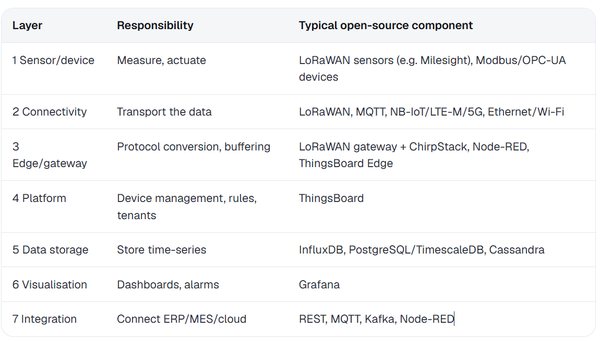

A starting prototype

This will ideally build a strong foundation that can be reused throughout. Meaning that adding additional sensors or data inputs wont require a complete rewriting down stream systems.
An adapter layer should be suffice. Also data should be sysmentic otherwise later on it will be difficult to do anything meaning with the data.

Sources:

· Brick Schema (GitHub) - https://github.com/BrickSchema/Brick 
· brickschema Python docs - https://brickschema.readthedocs.io/en/stable/
· Brick example server - https://github.com/BrickSchema/brick-example-server/blob/master/README.md 

· ASHRAE 223P – US DOE - https://www.energy.gov/cmei/buildings/ashrae-standard-223p 
· ASHRAE Standards Actions, Apr 2026 https://www.ashrae.org/file%20library/technical%20resources/standards%20and%20guidelines/standards%20actions/sa-apr_24_2026.pdf 
· 223P for district heating (Fraunhofer) https://publica.fraunhofer.de/handle/publica/505644 

· Haystack 5 / Xeto announcement https://marketing.project-haystack.org/project-haystack-media/press-releases/project-haystack-unveils-haystack-5-with-xeto-schema-language-and-rdf-integration-at-haystack-connect-2025 

· SAREF + Ditto paper (arXiv 2609.04213) https://arxiv.org/pdf/2609.04213 
· W3C SOSA/SSN https://www.w3.org/TR/2026/WD-vocab-ssn-2023-20260909/ 

· IDTA – Asset Administration Shell https://industrialdigitaltwin.org/?p=6954 
· ETSI NGSI-LD https://cim.etsi.org/NGSI-LD/official/introduction.html 
· W3C WoT TD 2.0 https://www.w3.org/news/2025/first-public-working-draft-web-of-things-wot-thing-description-2-0 

· SenML RFC 8428 https://datatracker.ietf.org/doc/rfc8428/ 
· OGC SensorThings https://en.wikipedia.org/wiki/SensorThings_API
· AsyncAPI https://asyncapi.com/docs/concepts/asyncapi-document
· Unified Namespace https://tractian.com/en/glossary/unified-namespace

## Architecture 
· https://wz-it.com/en/knowledge/
· OpenTwins (arXiv 2301.05560)  https://arxiv.org/pdf/2301.05560
· Open-source IoT/DT platforms compared  https://wz-it.com/en/knowledge/iot/open-source-iot-platforms-compared/
· https://wz-it.com/en/knowledge/iot/iot-architecture-layers/
· ISO 23247-2 https://www.iso.org/standard/78743.html

## Semantic layer
· Ontologies in Digital Twins SLR  https://dare.uva.nl/id/1fd181f2-a16b-4e49-ae77-2e85a7789877
· Operational DTs: semantic infrastructure review (ITcon 2026) https://itcon.org/paper/2026/43 

