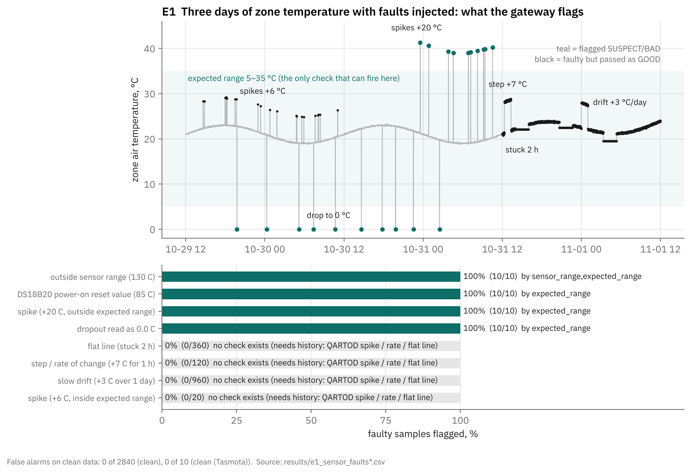
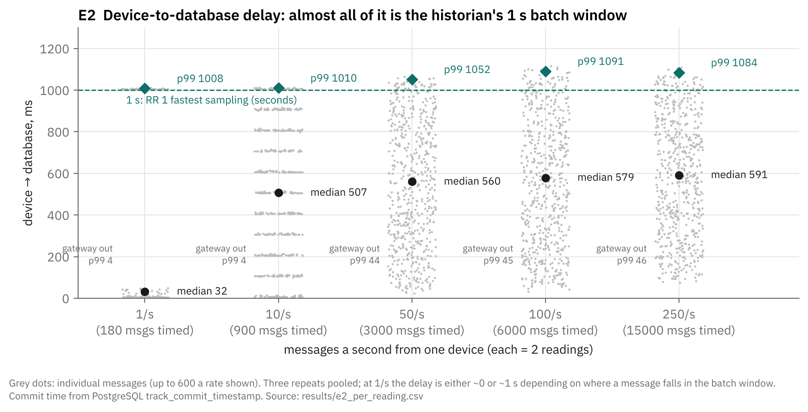
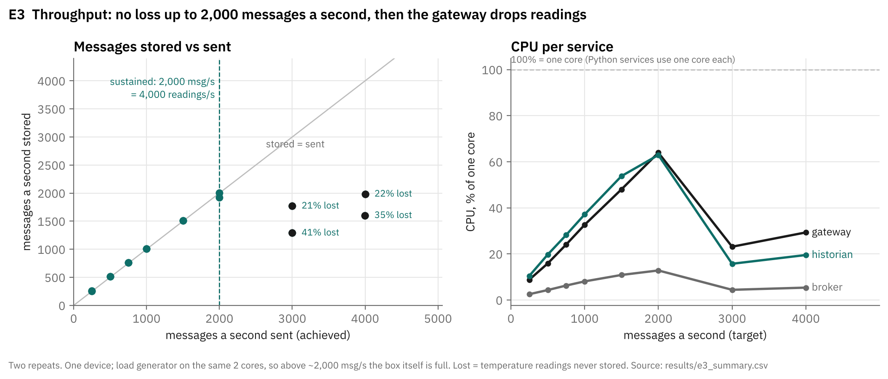
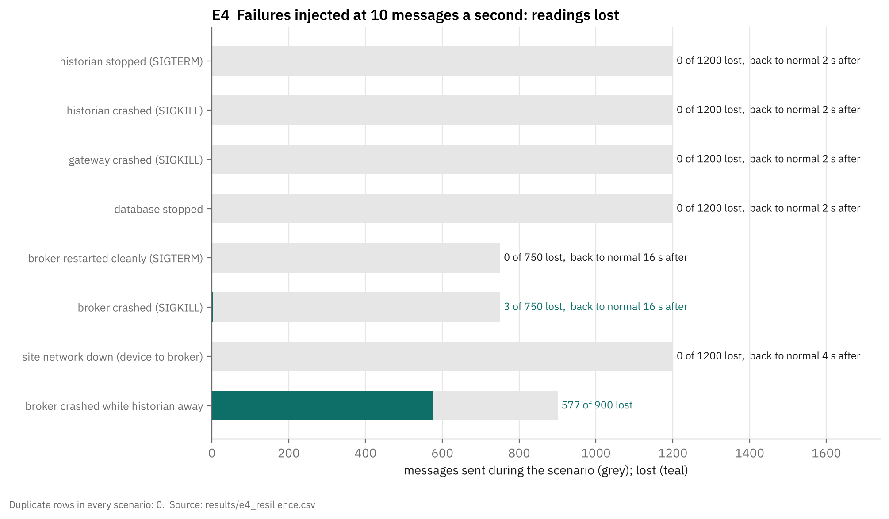
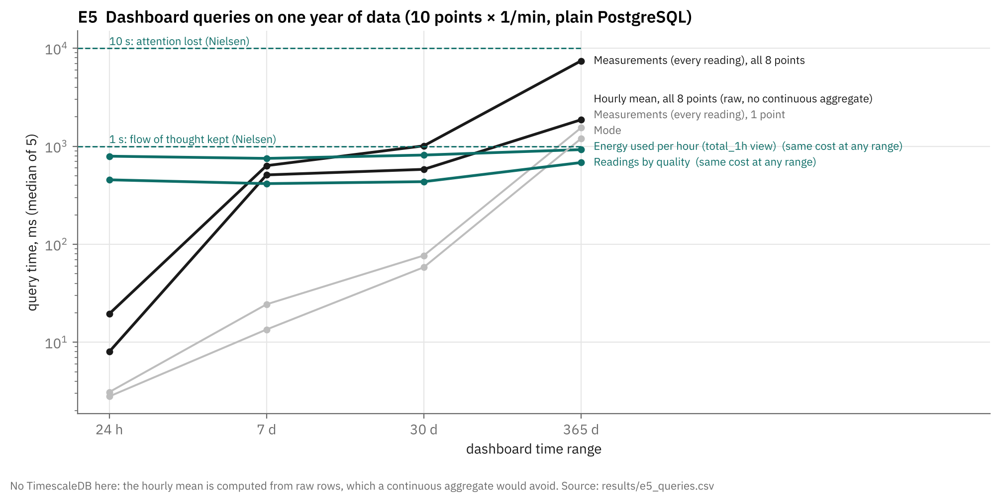

# v0.1 pipeline experiments: findings

What the v0.1 pipeline (devices → broker → gateway → historian → database) can and can't do today, measured.

## Results at a glance

| # | Question | Result | Against the criterion |
|---|---|---|---|
| E1 | Bad data | Bad formats, duplicates, out-of-order and missing values all handled; range checks catch 100% of out-of-range values with 0 false alarms. **Stuck, step, in-range spike and drift faults: 0% caught.** **NaN/Infinity stored as SUSPECT and turns summaries into NaN.** No completeness report. A clock 2 h slow passes as GOOD | **Partly met** |
| E2 | Device → database delay | 0 lost. p99 **1.01–1.11 s**, almost all of it the historian's 1 s batch window. With `BATCH_SECONDS=0.2`: p99 0.21–0.27 s | **Narrowly missed** at the default setting (1 s); met with one setting change; 50× inside the 60 s nominal limit |
| E3 | Throughput | **2,000 messages/s (4,000 readings/s) sustained** on 2 cores, i.e. 240,000 points at one a minute. Above that the gateway **drops 21–41% of readings** | Capacity far above need; overload behaviour is loss, not back-pressure |
| E4 | Failures | Historian, gateway and database failures, a network cut and a clean broker restart: **0 lost, 0 duplicates**, back to normal in 2–16 s. **Broker crash: 3 lost; broker crash while the historian was away: 577 of 900 lost** | **Met for 6 of 8** |
| E5 | A year of data | 139 bytes/reading (ADR-001 assumed 88). Everyday dashboard ranges answer in under 1 s. **Energy-per-hour panel costs 0.8 s whatever the range, and grows with history**; raw year-long views 1.5–7.5 s | **Met for everyday use; at risk as data grows** |
| E6 | Security | Logins and access rules: **22/22 as `acl.conf` says**. Gaps: **no TLS (password readable on the wire)**, shared test-device password | **Met**; 2 OWASP IoT Top 10 gaps for any customer site |
| E7 | Adding a device | New sensor model on a known format: **31 lines of configuration, 0 code**, worked first time; 2 unknown fields quarantined with clear reasons | Supports RR 1's integration-cost aim |

**What it can do today.**
- Take bad input without falling over, and keep every bad message with a reason.
- Survive any single application failure or network cut without losing or duplicating a reading.
- Handle about 24,000 times the lab rig's data rate on a small machine.
- Onboard a new sensor of a known type with configuration alone.

**Where it falls short, in order of importance.**
1. **The broker is the one place data can be lost.** It saves only every 60 s, so a crash loses what arrived since the last save, including sessions.
2. **Faults inside the normal range go unflagged.** No stateful checks: stuck, step, spike.
3. **NaN/Infinity get in** and corrupt the summaries.
4. **Overload drops readings** in the gateway instead of slowing it down.
5. **The energy panel's cost grows with history.**
6. **No TLS, and the test-device password is shared.**
7. **No per-point completeness figure** (an RR 1 requirement).
8. **Delay is just over 1 s** until the batch window is shortened.

The fixes are listed in section 3. None needs a redesign; most are settings or a few lines of code.

## 1. Method and pass criteria (written 1 Nov 2026, 13:05 UTC, before any run)

**How bias is kept out**
- Pass criteria come from the project's own Requirements Report (RR 1) and named standards, and were written down before anything ran.
- The code under test is frozen: `results/code_hashes.txt` lists the SHA-256 of every source file. Nothing gets tuned between runs.
- Every run is reported, including failures. Repeated runs show their spread.
- Measured numbers and projections from them are labelled separately.

| # | Question | Pass criterion | From |
|---|---|---|---|
| E1 | Does it handle bad data as RR 1 requires? | Duplicates: 0 extra rows. Out-of-order: 100% stored at their own time. Missing: never stored as zero, and completeness reported per point. Unknown sensor time: recorded as unknown, not substituted. Wrong clock: never GOOD. Malformed input: 100% quarantined, service stays up. Sensor faults: QARTOD *required* tests (gross range, climatology) **and** *strongly recommended* tests (spike, rate of change, flat line) detect the fault | RR 1 §5 data-quality table; QARTOD T/S manual table 3-2 |
| E2 | How long from device to database? | p99 below the fastest sampling interval in RR 1 ("seconds for batch transients", taken as 1 s); nominal limit 60 s ("minutes for zones", "one minute for electrical input") | RR 1 §5 sampling |
| E3 | How much can one machine take? | No pass mark. Capacity reported as points sampled once a minute, against the rig (10 points), one SME site and 100 sites | RR 1 §5; ADR-001 sizing |
| E4 | Does it recover from failures by itself? | Each failure: 0 readings lost, 0 duplicate rows, no manual action needed | RR 1 §9 "recovers without intervention"; §5 "repeat delivery harmless" |
| E5 | Storage growth and dashboard query speed over a year of data | Typical dashboard query ≤ 1 s (keeps "the user's flow of thought seamless"), never > 10 s | Nielsen, *Website Response Times* (NN/g, 2010); ADR-001 R7 cost |
| E6 | Are logins and access rules enforced, and what's left open? | 100% of the access-matrix attempts behave as `broker/acl.conf` says. Gaps judged against OWASP IoT Top 10 (2018) | OWASP IoT Top 10 items 1 and 7 |
| E7 | How much work is adding a device type? | No pass mark: lines of configuration vs code per device type already added | RR 1 §6 "integration is where the cost of onboarding a new site concentrates" |

**Test environment.** This is not the lab PC.
- Machine: a cloud Linux VM (2 vCPU Intel Xeon @ 2.1 GHz, 7.8 GB RAM, Ubuntu 24.04).
- Software: Python 3.13, Mosquitto 2.0.18, PostgreSQL 16.15 with default settings and **no TimescaleDB**.
- Setup: services run as processes, not Docker, and the load generator shares the same 2 cores.
- What the lab PC stack differs in: Mosquitto 2.0.22, PostgreSQL 18 + TimescaleDB 2.31 tuned by `timescaledb-tune`, Docker networking.
- So read absolute speeds as *this box*. Behaviour (lost, duplicated, flagged) should carry over. To repeat: `sh experiments/run_all.sh` on any Linux machine or WSL with Python, Mosquitto and PostgreSQL (settings at the top of `harness.py`).

## 2. Results

### E1 · Bad data (RR 1 §5)

**What was done.**
- **Sensor faults.** 3 days of zone temperature were generated, 1 sample a minute (21 °C ± 2 °C daily cycle, 0.1 °C noise). Labelled faults were injected into it and the series was fed through the gateway's own code.
- **Tasmota probe.** Its datasheet values were tried in the real Tasmota format.
- **Single bad messages.** 20 one-off bad messages: clock errors and malformed payloads.
- **Storage checks.** Duplicates, shuffled order, missing fields and NaN were sent end to end through the broker into the database.

| Fault | Flagged | By |
|---|---|---|
| Value outside the sensor's range (Tasmota 130 °C) | 10/10 BAD | sensor_range |
| DS18B20 power-on value 85 °C ([datasheet](https://user-web.icecube.wisc.edu/~kitamura/NK/Datasheets/Dallas_1Wire/DS18B20.pdf): "power-on reset value … is +85°C") | 10/10 SUSPECT | expected_range |
| Spike +20 °C (leaves 5–35 °C) | 10/10 SUSPECT | expected_range |
| Sensor drops to 0 °C | 10/10 SUSPECT | expected_range |
| Spike +6 °C (stays inside 5–35 °C) | **0/20** | – |
| Step +7 °C for 1 h | **0/120** | – |
| Stuck at one value for 2 h | **0/360** | – |
| Slow drift +3 °C over a day | **0/960** | – |
| Clean data (false alarms) | 0/2,850 | – |

| Single message | Expected | Observed | |
|---|---|---|---|
| Clock 1 day / 30 min ahead | not GOOD | BAD (future_time) | ✔ |
| Clock reset to 1970 (power loss) | not GOOD | SUSPECT (late_arrival) | ✔ |
| Clock **2 h behind** | not GOOD | **GOOD** | ✘ |
| No timestamp | recorded as unknown (RR 1) | stored with the gateway's time, labelled `time_source=gateway` | partial |
| Tasmota local time in the repeated hour (25 Oct, 01:30) | flagged | quarantined: "happens twice … can't tell which" | ✔ |
| Not JSON, empty, array, text timestamp, text / null / true / "70.5" temperature, unknown mode code, unknown field / device / vendor (12 cases) | quarantined | all 12 quarantined, with a reason | ✔ |
| Temperature **NaN** or **Infinity** | quarantined or BAD | **stored as SUSPECT** | ✘ |

| Through the whole pipeline | Result | |
|---|---|---|
| 200 messages sent twice | 200 rows (the historian logged and skipped the copies) | ✔ |
| 200 messages in shuffled order | 200 rows, each value at its own time | ✔ |
| 50 of 100 messages missing the temperature | 50 rows, no zeros | ✔ |
| Completeness reported per point | nothing in the database reports it | ✘ |
| One NaN in an hour of readings | **that hour's mean and max become NaN** (summaries leave out BAD only, and NaN is SUSPECT) | ✘ |
| Services still running after all of it | yes | ✔ |

**What it means.**
- The gateway does what it says it does. Range checks catch every value that leaves its range, with no false alarms on clean data. Bad formats never get in, duplicates and out-of-order data are harmless, and missing values stay missing.
- The faults a thermal twin most needs to catch are the ones that stay *inside* the range: a stuck sensor, a step, drift. They pass as GOOD, because those checks need each point's previous readings and v0.1's checks deliberately look at one reading at a time (`validator.py`, "Not done yet").
- QARTOD lists spike, rate of change and flat line as **strongly recommended** ([QARTOD T/S manual](https://cdn.ioos.noaa.gov/media/2020/03/QARTOD_TS_Manual_Update2_200324_final.pdf), table 3-2), so that criterion is **not met**.
- Drift is a different matter: RR 1 gives it to the twin (compare sensors, watch the model's parameters), not to the gateway.
- **Bug found:** NaN/Infinity is a number in Python and JSON, so it passes the type check, fails the range comparison only by accident, and is stored as SUSPECT. A single NaN reading silently turns that hour's summaries into NaN.

### E2 · Device-to-database delay

**What was done.** One device sent at 1, 10, 50, 100 and 250 messages a second, 3 repeats each, 25,080 messages in total.
- **Start of the clock:** the device's `publish()` call.
- **Gateway timing:** a read-only watcher timed the canonical message leaving the gateway.
- **Stored:** PostgreSQL's own commit time for each row.

| Messages/s | Lost | Median | p95 | p99 | Gateway out, p99 |
|---|---|---|---|---|---|
| 1 | 0 | 30–509 ms | 1,006 ms | 1,008 ms | 2–4 ms |
| 10 | 0 | 507 ms | 1,006 ms | 1,008–1,012 ms | 3–4 ms |
| 50 | 0 | 552–563 ms | 1,013 ms | 1,046–1,054 ms | 44–59 ms |
| 100 | 0 | 570–584 ms | 1,027–1,059 ms | 1,070–1,110 ms | 44–45 ms |
| 250 | 0 | 591 ms | 1,041 ms | 1,081–1,089 ms | 45–46 ms |

(Ranges are the spread over the 3 repeats.)

**What it means.**
- Nothing was lost at any of these rates.
- The criterion "p99 below 1 s" is **missed narrowly** (1.01 to 1.11 s), and the cause is visible. The historian writes a batch 1 s after the first message in it (`BATCH_SECONDS = 1.0`), so a reading waits anywhere from 0 to 1 s. The gateway itself takes milliseconds.
- At 1 message a second the delay is either ~0 or ~1 s, depending on where messages fall against that 1 s timer. That's why the median ranges from 30 to 509 ms between repeats.
- **Setting, not code (E2b):** with `BATCH_SECONDS=0.2`, p99 drops to 209 ms at 10/s, 252 ms at 100/s and 271 ms at 250/s. Nothing was lost, and historian CPU went from 0.8% to 1.3% at 10/s. That clears the 1 s criterion with room to spare. The cost is more, smaller database transactions.
- Against the nominal RR 1 limit (60 s for zones and electrical input), the delay is 50 times inside it.
- The gateway step from ~4 ms to ~45 ms at 50 messages/s or more looks like TCP's Nagle algorithm. Mosquitto leaves `set_tcp_nodelay` off by default ([mosquitto.conf](https://mosquitto.org/man/mosquitto-conf-5.html)). **E2c confirmed it:** at 100 messages/s with `set_tcp_nodelay true`, gateway-out p99 fell from 44 ms to 4 ms (median 23 ms to 1 ms).

### E3 · Throughput: how much can one machine take?

**What was done.**
- One device sent at 250 to 4,000 messages a second, 20 s per rate, 2 repeats.
- Measured: what the broker accepted, what was stored, what the gateway reported dropping, and the CPU and memory of each service.
- "Sustained capacity" was defined before running: the highest rate with ≥ 95% stored and the backlog cleared within 5 s.

| Messages/s | Stored | Temperature readings lost | Gateway logged as dropped | p99 delay | CPU: gateway / historian / broker |
|---|---|---|---|---|---|
| 250 | 100% | 0 | 0 | 1.08 s | 9% / 10% / 3% |
| 1,000 | 100% | 0 | 0 | 0.36–0.38 s | 32% / 37% / 8% |
| 1,500 | 100% | 0 | 0 | 0.32–0.37 s | 48% / 54% / 11% |
| **2,000** | 100% | 0 | 0 | 0.78–1.72 s | 64% / 63% / 13% |
| 3,000 | – | **21% / 41%** | 49,867 / 49,762 readings | 7.8 s | 23% / 16% / 4% |
| 4,000 | – | **22% / 35%** | 69,999 / 69,781 readings | 11.5–12.4 s | 29% / 20% / 5% |

(Pairs of numbers are the two repeats. Memory stayed small: gateway 43 → 65 MB, historian 63 MB, broker 9 → 24 MB.)

**What it means.**
- **Sustained capacity on this 2-core box: 2,000 messages a second = 4,000 readings a second**, with nothing lost.
  - That is 240,000 points read once a minute, or 40,000 every 10 s.
  - The lab rig (10 points) uses about 1/24,000 of it.
  - Projected, not measured: many devices each with their own connection weren't tested, and at 2,000/s the box itself (services plus load generator) was full.
- **Above that, the gateway drops readings rather than slowing down.**
  - **What happens:** it acknowledges each raw message as soon as it has read it (paho's default). It then queues its outputs, with the queue capped at 10,000 (`MAX_QUEUED`). Once the queue is full, new readings are refused and logged as `ERROR publish_dropped`, but the raw message has already been acknowledged, so the broker won't resend it.
  - **Why it matters:** the loss is logged, not silent, but it is still loss.
  - **The fix exists already:** the historian avoids this by acknowledging only after its work is done (manual ack). The same pattern in the gateway would turn overload into back-pressure (slower, nothing lost).
- *First attempt discarded:* the first E3 run had a harness bug that gave runs overlapping sensor times, so new readings collided with old ones. It is kept in `results/logs/` marked INVALID. The dropping behaviour showed up there too.

### E4 · Failures

**What was done.**
- A device sent 10 messages a second throughout, the way the vendor publishers do (paho defaults, QoS 1).
- In each scenario, one part was broken 20 s in and put back after the outage, then the backlog was allowed to clear. "Put back" stands in for Docker's `restart: unless-stopped` or the network returning.
- The network cut used a relay between the device and the broker that drops every connection.

| Scenario | Outage | Sent | Lost | Duplicate rows | Back to normal after |
|---|---|---|---|---|---|
| Historian stopped | 60 s | 1,200 | 0 | 0 | 1.8 s |
| Historian killed (SIGKILL) | 60 s | 1,200 | 0 | 0 | 1.8 s |
| Gateway killed | 60 s | 1,200 | 0 | 0 | 1.8 s |
| Database stopped | 60 s | 1,200 | 0 | 0 | 2.5 s |
| Site network down, device ↔ broker | 60 s | 1,200 | 0 | 0 | 4.5 s |
| Broker restarted cleanly | 15 s | 750 | 0 | 0 (24 copies skipped) | 16.2 s |
| Broker killed | 15 s | 750 | **3** | 0 | 16.2 s |
| Broker killed **while the historian was away** | 30 s | 900 | **577 (64%)** | 0 | n/a |

**What it means.**
- **Six of the eight lose nothing:**
  - Every application failure (historian, gateway, database), a 60 s network cut and a clean broker restart lost nothing and duplicated nothing.
  - Each recovered within seconds of the part coming back, with no manual step.
  - That is the store-and-ack design (ADR-002 §7) doing its job: messages wait in the broker's sessions and are acknowledged only after the database commit.
- **The broker is the weak point.** It is the one place readings wait, and it saves its memory to disk only every 60 s (`autosave_interval 60`, broker/mosquitto.conf).
  - **Clean restart:** it saves on the way down, so nothing is lost.
  - **Kill:** whatever arrived since the last save is gone. That covers messages it has already acknowledged to the sender and *the sessions themselves*. In the last scenario the crash came before the first save, so both the gateway's and the historian's sessions were lost (both logs show `session_present=false` on reconnect).
  - **Why 577:** the device's resent backlog then went through the gateway to a historian that hadn't subscribed yet. The 577 lost are about 250 readings queued for the historian, the ~300 the device sent while the broker was down, and a few just after.
- **The device side held up:** paho kept unacknowledged messages and resent them after reconnecting (0 lost in the network cut).
  - Its reconnect wait grows the longer the outage lasts (paho backs off between attempts), which most likely set the 16 s recovery after a 15 s broker outage.
  - The buffer is in memory, so a device that reboots during an outage loses it. RR 1's hybrid option, buffering at the edge, is not built yet.
- Criterion (0 lost, 0 duplicates, no manual step): **met for 6 of 8**. **Not met** when the broker itself crashes.

### E5 · Storage and dashboard speed over a year

**What was done.**
- Filled a copy of the database with one year of readings for the 10 points in the asset model, one a minute: 5,256,000 rows of the same shape the historian writes.
- Timed each dashboard query (the SQL in `grafana/dashboards/dtteo-overview.json`) over 24 h, 7 d, 30 d and 365 d, 5 runs each.
- No TimescaleDB here: this is plain PostgreSQL. The hourly-mean panel normally reads the `summary_1h` continuous aggregate, so here it is computed from raw rows (the slow case).

**Size:** **139 bytes per reading** (108 for the row, 32 for the index). That's 73 MB per point per year at one reading a minute, uncompressed. ADR-001 estimated 88 bytes, so it is 58% higher than planned.

| Scale (1 reading/min per point) | Per year, uncompressed |
|---|---|
| Lab rig, 10 points | 0.7 GB |
| One SME site, ~50 points | 3.7 GB |
| 100 sites | 370 GB |

These are projected from the measured 139 bytes. At 10 s sampling, multiply by 6. TimescaleDB compression would shrink this, but it wasn't measured here.

| Dashboard query | 24 h | 7 d | 30 d | 365 d |
|---|---|---|---|---|
| Every reading, 1 point | 3 ms | 24 ms | 77 ms | 1.5 s (525,600 rows) |
| Every reading, 8 points | 20 ms | 0.6 s | **1.0 s** | **7.5 s** (3.7 M rows) |
| Hourly mean, 8 points (raw: no aggregate here) | 8 ms | 0.5 s | 0.6 s | **1.9 s** |
| **Energy used per hour** (`total_1h` view) | **0.8 s** | **0.8 s** | **0.8 s** | **0.9 s** |
| Mode | 3 ms | 14 ms | 58 ms | 1.2 s |
| **Readings by quality** | **0.46 s** | **0.42 s** | **0.44 s** | **0.68 s** |

(Median of 5 runs. The first, cold run of the energy query took 3.5 s.)

**What it means.**
- **Everyday ranges are fine.** Every panel answers in under 1 s for 24 h and 7 d.
- **Two queries cost the same whatever the range, and will grow with history:**
  - **Energy used per hour** is a plain view that works out each meter step with a window function over *every* reading of the meter, before the time filter applies. The query plan reads all 525,599 rows to return 24. At 0.8 s for one meter and one year, it crosses the 1 s criterion as history or meters are added. A hypertable wouldn't help, because the filter can't be pushed below the window function.
  - **Readings by quality** filters on time alone, and the only index is (series, time), so it scans the whole table. Here it is 0.45 s for 10 points; with 10 times the points it would be several seconds. On the lab PC this one should be fine (untested): TimescaleDB splits the table by time and skips chunks outside the range.
- **Year-long raw plots of many points** take 7.5 s, close to the 10 s limit. They are what the hourly continuous aggregate exists for, and it couldn't be tested here.
- Criterion (≤ 1 s typical, never > 10 s): **met for the everyday ranges**. **At risk** for the energy panel as history grows, and for raw year-long views.

### E6 · Logins and access rules

**What was done.**
- **Access matrix.** 22 attempts were made covering every login: connect, publish to topics it should and shouldn't, and subscribe. A watcher with full read access recorded what actually got through.
- **On the wire.** A relay recorded one device's login packet as a network observer would see it.

| | Result |
|---|---|
| No login / wrong password / unknown name | 3/3 refused ("Not authorized") |
| Each login doing what `acl.conf` allows | 8/8 got through |
| Each login trying what `acl.conf` doesn't allow: another device's topic, canonical data from a device, faking the gateway's status, a device or the historian reading data it shouldn't, the historian or engineer publishing | 10/10 blocked |
| Acme's password used to log in as the Borealis device | **accepted**: the test devices share one password |
| Login packet on the network | `..MQTT...acme_hvac_0001..acme_hvac_0001..devpw`: **password readable** |

**What it means.**
- The rules do exactly what `broker/acl.conf` says: **22/22 as expected**. Note that a refused publish is dropped silently (MQTT 3.1.1 has no way to say "denied"), which is why the smoke test watches for it rather than checking a return code.
- Against OWASP IoT Top 10 (2018), two gaps remain:
  - **I1 "Weak, guessable, or hardcoded passwords":** the shared test-device password. Anyone with one device's password can publish as any test device. `start.sh` already says real devices get their own.
  - **I7 "Insecure data transfer and storage":** no TLS. MQTT sends credentials "in plain text" ([HiveMQ](https://www.hivemq.com/blog/mqtt-security-fundamentals-authentication-username-password)), as captured above.
- Both are acceptable on an isolated lab network. Neither is acceptable on a customer site.

### E7 · Adding a device

**What was done.**
- Counted what each existing device type needed.
- Added a new one live, in a scratch copy of the model folder: a Tasmota board with a BME280 sensor (temperature, humidity, pressure), using the existing Tasmota decoder. Its message shape follows the Tasmota wiki's BME280 page.

| Device type | Configuration (lines) | Decoder (Python lines) |
|---|---|---|
| Acme (made-up) | 23 | 35 (new format) |
| Borealis (made-up) | 20 | 42 (new format) |
| Tasmota DS18B20 | 17 | 95 (new format) |
| Eastron SDM120 (Modbus) | 37 | 80 (new format) |
| **Tasmota BME280, added in this experiment** | **31** (type + binding) | **0** (reuses Tasmota) |

**First message from the new device:**
- **Temperature:** came out right first time (`unit1.zone_air_temp = 21.7 °C, GOOD`).
- **Humidity and pressure:** counted and dropped as optional fields, because the asset model has no point for them yet.
- **Two fields went to quarantine:**
  - `DewPoint`: I hadn't listed it in the type.
  - `PressureUnit`: the Tasmota decoder treats only `Time` and `TempUnit` as labels, so a pressure sensor's `PressureUnit: "hPa"` looks like a reading.

**What it means.**
- **Same format:** a new sensor model that speaks a format we already decode is configuration only (about 30 lines, no code). That backs up RR 1's point that onboarding cost lives in integration.
- **New format:** a new vendor format is a decoder of 35 to 95 lines.
- **Quarantine doing its job:** nothing was silently lost. The two surprises went to quarantine with a reason that says what to change. One is a one-line decoder fix (add `PressureUnit` to the labels), the other a type entry.

## 3. What to fix (proposed for v0.2, not done here)

v0.1 stays as tested. Each fix below names the experiment that re-checks it.

| # | Fix | Size | Re-check |
|---|---|---|---|
| 1 | Broker durability: save on every change, or move to Mosquitto 2.1's SQLite persistence (already noted in `broker/mosquitto.conf`) | Setting / image | E4 broker-crash scenarios |
| 2 | Gateway: acknowledge raw messages only after its outputs are accepted (the historian's manual-ack pattern) | Small code change | E3 at 3,000–4,000/s |
| 3 | Normaliser: send NaN and Infinity to quarantine (`math.isfinite`) | A few lines | E1 |
| 4 | Stateful checks: QARTOD spike, rate of change, flat line, keeping a short history per point (ioos_qc has all three) | Medium | E1 sensor faults |
| 5 | `BATCH_SECONDS=0.2` and `set_tcp_nodelay true` | 2 settings | E2 |
| 6 | Energy per hour: compute within the time range (e.g. a continuous aggregate of each meter's hourly first/last) instead of a whole-history window function | Medium (migration) | E5 |
| 7 | Completeness per point: expected vs received readings per hour, as a view | Small (migration) | E1 |
| 8 | Before any customer site: TLS on the broker, one password per device | Setting + certificates | E6 |
| 9 | Tasmota decoder: treat `PressureUnit` as a label | One line | E7 |
| 10 | Clock offset: track each device's (ingest − sensor) time and flag when it jumps. A single reading can't show a 2 h slow clock | Small–medium | E1 |

## 4. Files

- `harness.py`: starts and stops the services, the test device, result queries.
- `e1_…` to `e7_…`: one script per experiment. `figures.py` draws the charts from the CSVs. `run_all.sh` runs everything, about an hour.
- `results/`: every CSV behind every table above, `code_hashes.txt`, console output (`logs/`) and every service's log (`service_logs.tar.gz`).
- `figures/`: the charts.

**Sources:**
- RR 1 Requirements Report (project files), §5, §6 and §9.
- [QARTOD temperature/salinity manual, table 3-2](https://cdn.ioos.noaa.gov/media/2020/03/QARTOD_TS_Manual_Update2_200324_final.pdf).
- [Nielsen, *Website Response Times*, NN/g](https://www.nngroup.com/alertbox/response-times.html).
- [OWASP IoT Top 10 2018](https://www.networkworld.com/article/966868/top-10-iot-vulnerabilities.html), via Network World; the OWASP PDF wasn't reachable.
- [HiveMQ, MQTT authentication](https://www.hivemq.com/blog/mqtt-security-fundamentals-authentication-username-password).
- [mosquitto.conf manual](https://mosquitto.org/man/mosquitto-conf-5.html) (`set_tcp_nodelay`, `autosave_interval`).
- [DS18B20 datasheet](https://user-web.icecube.wisc.edu/~kitamura/NK/Datasheets/Dallas_1Wire/DS18B20.pdf).
- [Tasmota BME280 message shape](https://github.com/stodev-com-br/tasmota/wiki/BME280).
